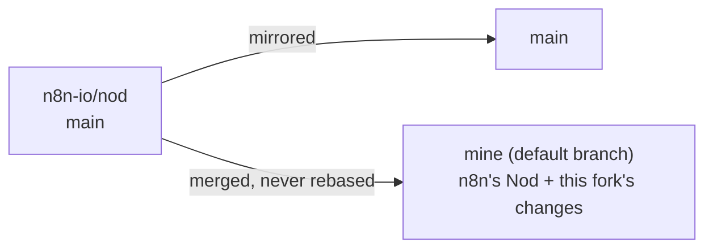

# Nod, with task chats and backup models

[](https://github.com/n8n-io/nod)
[](https://github.com/mohamed0s/nod/releases/latest)
[](https://github.com/mohamed0s/nod/blob/mine/LICENSE)

A community fork of [Nod](https://github.com/n8n-io/nod), the open source personal agent from the team behind n8n. Nod has its own computer and browser, runs errands on real websites, runs on your machine with the model you choose, and asks before it acts for you.

This fork follows n8n's `main` closely and adds a few changes on top. Everything else works as in n8n's Nod, so [n8n's README](https://github.com/n8n-io/nod#readme) and the [Nod docs](https://nod.n8n.io/docs/) cover it.

> [!NOTE]
> This fork isn't made or supported by n8n. Before you report a bug to n8n, check that it also happens in [n8n's own Nod](https://github.com/n8n-io/nod/releases/latest).

## What this fork adds

| Change                        | What you get                                                                                                                                                                                                                                                                                                                                                                                                                                                                                                                                             |
| ----------------------------- | -------------------------------------------------------------------------------------------------------------------------------------------------------------------------------------------------------------------------------------------------------------------------------------------------------------------------------------------------------------------------------------------------------------------------------------------------------------------------------------------------------------------------------------------------------- |
| **Each task is its own chat** | A chat list beside **Main**, with **New chat** and one chat per task, grouped into Working, Needs you and Done. A task chat shows only its own messages, live browser and Stop, and sees only its own history. Rename or close any chat. On Telegram, each task gets its own topic. Memory, rules, Vault, files and schedules stay shared. [Tasks](https://github.com/mohamed0s/nod/blob/mine/docs/src/content/docs/use/tasks.md) · [Telegram topics](https://github.com/mohamed0s/nod/blob/mine/docs/src/content/docs/use/channels.mdx#telegram-topics) |
| **Backup models**             | **Settings → Models** keeps up to three backup models. When the model in use is busy or unavailable (a rate limit, an overload, a timeout, a network or quota error), Nod retries it once, then moves the same request to each backup in turn. Action checks start again on the backup, so one check never mixes models, and the reply says which model answered. [Backup models](https://github.com/mohamed0s/nod/blob/mine/docs/src/content/docs/connect/models.mdx#backup-models)                                                                     |
| **Job search**                | A **Jobs** page keeps your CVs (one marked main), the job profile Nod drafts from it, and your referral message templates, with right-to-left text and morning and evening greetings. Nod scores jobs with [career-ops](https://github.com/career-ops-hq/career-ops), installed in the workspace image. [Job search](https://github.com/mohamed0s/nod/blob/mine/docs/src/content/docs/use/job-search.md)                                                                                                                                                 |
| **Windows, from source**      | One install script. Nod starts at every Windows sign-in, backs itself up every night, can wake the PC for morning schedules, and takes n8n's updates with one command.                                                                                                                                                                                                                                                                                                                                                                                   |
| **Windows installer**         | A GitHub Actions workflow builds and publishes a Windows installer each time the fork takes in an n8n release. Apps installed from it update themselves from this fork's releases, never from n8n's.                                                                                                                                                                                                                                                                                                                                                     |
| **Private by default**        | The Windows install script turns off usage data (`NOD_ANALYTICS_ENABLED=false`) and conversation traces (`NOD_TRACES_URL=`).                                                                                                                                                                                                                                                                                                                                                                                                                             |

## Install

### Windows app

Download [nod-Setup-x64.exe](https://github.com/mohamed0s/nod/releases/latest/download/nod-Setup-x64.exe) from this fork's [latest release](https://github.com/mohamed0s/nod/releases/latest). It needs Windows 11 x64, WSL 2 and 20 GB of free disk space. The installer isn't code-signed, so Windows SmartScreen asks you to confirm it once.

After that, the app updates itself from this fork's releases, the way n8n's app updates from n8n's. It checks when it starts and every six hours, downloads the new installer in the background, checks it against the release's SHA-256, and offers **Restart to update**. A new release follows each n8n release the fork takes in, so releases can trail the `mine` branch. Each person's data stays on their own computer.

The first release, 0.9.1, can't update itself. If you installed it, install the latest release by hand once.

### From source on Windows 11

You need [Docker Desktop](https://www.docker.com/products/docker-desktop/) installed and started once, [Git](https://git-scm.com/), and about 20 GB free. The install script gets Node.js 24 and pnpm if they're missing.

```powershell
git clone https://github.com/mohamed0s/nod.git
cd nod
powershell -ExecutionPolicy Bypass -File scripts\windows\install.ps1
```

The script:

1. **Checks Node.js and pnpm,** and installs them if they're missing.
2. **Starts Docker Desktop,** if it isn't running.
3. **Creates `.env`,** with a new Vault key and usage data and traces turned off.
4. **Starts Nod at every Windows sign-in,** through the scheduled task `\Nod\start`.
5. **Backs Nod up every night at 03:30,** through the scheduled task `\Nod\backup`. It saves the database, the `.local` folder, and the browser and tools volumes into the `nod-backups` folder next to this one, and keeps the newest 14. The Vault key isn't saved.
6. **Adds a `nod` desktop shortcut.**
7. **Starts Nod and opens it in your browser.** The first start builds four containers and can take 10 minutes or more.

**Save the `NOD_VAULT_KEY` line from `.env` in your password manager.** Saved logins can't be read without it.

**Morning schedules while the PC sleeps (optional).** Add `-WakeAt 07:20` to the install command. The scheduled task `\Nod\wake` then wakes the PC from sleep at that time and keeps it awake for 90 minutes, starting Nod if it isn't running. It can't wake a PC that's shut down, and wake timers must be allowed in Windows' power options (they are by default).

### From source on macOS or Linux

The fork's changes aren't tied to Windows, but the fork is only tested there, and the Windows scripts don't apply. Follow n8n's [Install from source](https://nod.n8n.io/docs/get-started/install-from-source/) with this fork's address:

```sh
git clone https://github.com/mohamed0s/nod.git
cd nod
corepack enable
pnpm start
```

## Day to day on Windows

| To                         | Do this                                                                     |
| -------------------------- | --------------------------------------------------------------------------- |
| Open Nod                   | Double-click the `nod` shortcut, or go to `http://localhost:4310`           |
| Stop Nod                   | `powershell -File scripts\windows\stop.ps1`                                 |
| Start Nod again            | `Start-ScheduledTask -TaskPath '\Nod\' -TaskName start`, or sign out and in |
| Get n8n's latest changes   | `powershell -ExecutionPolicy Bypass -File scripts\windows\update.ps1`       |
| See what happened at start | `.local\windows-start.log`                                                  |
| Back up now                | `powershell -ExecutionPolicy Bypass -File scripts\windows\backup.ps1`       |
| Stop the morning wake      | `Unregister-ScheduledTask -TaskPath '\Nod\' -TaskName wake -Confirm:$false` |

## How this fork stays in step with n8n



- **`main`** is an exact copy of n8n's `main`.
- **`mine`**, the default branch, is n8n's Nod plus this fork's changes, one small commit per change.
- **n8n's updates are merged into `mine`, never rebased,** so its history is never rewritten and `git pull` always works.
- **`scripts\windows\update.ps1` does it all:** it stops Nod, merges n8n's latest `main`, pushes both branches to your GitHub copy if you have one, and starts Nod again. If n8n's changes clash with the fork's, it changes nothing and says so.
- **Changes that could help everyone are offered to n8n,** starting with [backup models](https://github.com/n8n-io/nod/discussions/1306).

## Build a Windows installer

n8n's own release workflow runs only in n8n's repository: it needs their paid build machines and signing keys. This fork has its own, **Fork Windows release**, and it runs by itself.

1. **Each n8n release starts it.** n8n marks a release by changing `desktop/release.json`. When `scripts\windows\update.ps1` pushes a merge that changes it to `mine`, the workflow builds a release. If the fork already has a release for that n8n version, it builds nothing.
2. **Versions follow n8n's.** n8n's 0.9.1 becomes 0.9.100, and another build of it 0.9.101. n8n's 0.9.2 becomes 0.9.200.
3. **It builds and checks the installer** on GitHub's machines, then publishes `nod-v<version>` as the fork's latest release. The runtime, about 1.5 GB, is rebuilt only when its inputs change or once a week; otherwise it's copied from an earlier release, so installed apps download only the new installer.
4. **To build one by hand**, open **Actions → Fork Windows release → Run workflow** on `mine`. Leave the version empty to number it as above, or enter one higher than every `nod-v` tag on the fork.

Runs never overlap. A new run waits for the running one, and a newer waiting run replaces an older one. To share a build, send the release link.

The installers aren't code-signed. A fork that signed them in GitHub Actions would keep the key in the same GitHub account as the releases, so a certificate wouldn't add protection, only setup on every PC. Installed apps trust this fork's releases instead: they check each installer's SHA-256 against the release, and still refuse one with a broken signature or another publisher's. See [How installed apps update](https://github.com/mohamed0s/nod/blob/mine/docs/src/content/docs/contribute/desktop-releases.mdx#how-installed-apps-update).

## Troubleshooting

- **"Could not resolve host" or "no such host" during the first start.** Docker Desktop's built-in name lookup can drop requests on some networks.
  1. In Docker Desktop, open **Settings → Docker Engine**.
  2. Add `"dns": ["1.1.1.1", "8.8.8.8"]`.
  3. Apply and restart, then start Nod again.
- **C: is nearly full.** In Docker Desktop, open **Settings → Resources → Advanced**, and move the disk image location to another drive before the first start.

## Credits and license

Nod is made by [n8n](https://n8n.io) and licensed under the [Apache License 2.0](https://github.com/mohamed0s/nod/blob/mine/LICENSE). This fork's changes use the same license. Bundled third-party terms are in [NOTICE](https://github.com/mohamed0s/nod/blob/mine/NOTICE).

The job search uses [career-ops](https://github.com/career-ops-hq/career-ops) by Santiago Fernández de Valderrama and contributors, under the MIT license. The workspace image installs a pinned commit (`abefa6dbdb57fd2971c0d24ec563f24de57477ca`, version 1.39.0) and checks its SHA-256; see [`install-career-ops.sh`](https://github.com/mohamed0s/nod/blob/mine/jobs/workspace/install-career-ops.sh).

This fork isn't affiliated with or endorsed by n8n GmbH.
