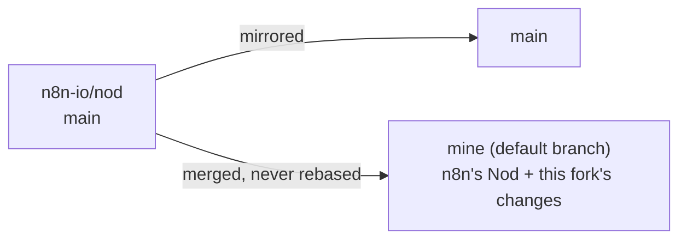

# Nod, with task chats and job search

[](https://github.com/n8n-io/nod)
[](https://github.com/mohamed0s/nod/releases/latest)
[](https://github.com/mohamed0s/nod/blob/mine/LICENSE)

A community fork of [Nod](https://github.com/n8n-io/nod), the open source personal agent from the team behind n8n. Nod has its own computer and browser, runs errands on real websites, runs on your machine with the model you choose, and asks before it acts for you.

This fork follows n8n's `main` closely and adds a few changes on top. Everything else works as in n8n's Nod, so [n8n's README](https://github.com/n8n-io/nod#readme) and the [Nod docs](https://nod.n8n.io/docs/) cover it.

> [!NOTE]
> This fork isn't made or supported by n8n. Before you report a bug to n8n, check that it also happens in [n8n's own Nod](https://github.com/n8n-io/nod/releases/latest).

## What this fork adds

| Change                        | What you get                                                                                                                                                                                                                                                                                                                                                                                                                                                                                                                                                                                                                                                                                                                                                                                                                                                                                                                                                                                                                                                                                                                                                                                                                                                                                                                                |
| ----------------------------- | ------------------------------------------------------------------------------------------------------------------------------------------------------------------------------------------------------------------------------------------------------------------------------------------------------------------------------------------------------------------------------------------------------------------------------------------------------------------------------------------------------------------------------------------------------------------------------------------------------------------------------------------------------------------------------------------------------------------------------------------------------------------------------------------------------------------------------------------------------------------------------------------------------------------------------------------------------------------------------------------------------------------------------------------------------------------------------------------------------------------------------------------------------------------------------------------------------------------------------------------------------------------------------------------------------------------------------------------- |
| **Each task is its own chat** | A chat list beside **Main**, with **New chat** and one chat per task, grouped into Working, Needs you and Done. A task chat shows only its own messages, live browser and Stop, and sees only its own history. Rename or close any chat. On Telegram, each task gets its own topic. Memory, rules, Vault, files and schedules stay shared. [Tasks](https://github.com/mohamed0s/nod/blob/mine/docs/src/content/docs/use/tasks.md) · [Telegram topics](https://github.com/mohamed0s/nod/blob/mine/docs/src/content/docs/use/channels.mdx#telegram-topics)                                                                                                                                                                                                                                                                                                                                                                                                                                                                                                                                                                                                                                                                                                                                                                                    |
| **Job search**                | A **Jobs** page keeps your CVs (one marked main), the job profile Nod drafts from it, and your referral message templates, with right-to-left text and greetings for the time of day. Nod finds jobs with [career-ops](https://github.com/career-ops-hq/career-ops) scans, public Telegram channels and job-alert emails and lists each one once on a **Postings** tab, and the **Job radar** messages you the new ones worth a look every morning at 07:30. A **Companies** tab shows each company's postings and the people you invited there, filtered by who is waiting to accept, to be asked or to reply, and which companies are no luck. For every accept, Nod fills in your template, tailors it once with its small model and sends it to you on Telegram, ready to paste, and it paces invites in waves of 5, up to 10, within your daily and weekly limits. Ticking **No luck, apply here** opens one apply chat for that company. A browser helper you install separately can pair on the **Helper** tab and log invites and show who accepted, through its own signed routes on this computer. [Job search](https://github.com/mohamed0s/nod/blob/mine/docs/src/content/docs/use/job-search.md) · [Paired helper](https://github.com/mohamed0s/nod/blob/mine/docs/src/content/docs/use/job-search.md#a-paired-browser-helper) |
| **Pages**                     | A **Pages** tab keeps the trackers, dashboards and reports Nod makes as living HTML pages, and a schedule can refresh one every morning instead of sending a new file each time. Each page keeps its last 10 versions. Pages run sandboxed with no network; a click opens only the public `https://` links written in the page itself, in a new tab. Keep any HTML file from chat with **Keep in Pages**. [Pages](https://github.com/mohamed0s/nod/blob/mine/docs/src/content/docs/use/pages.md)                                                                                                                                                                                                                                                                                                                                                                                                                                                                                                                                                                                                                                                                                                                                                                                                                                            |
| **Live desktop development**  | `pnpm run desktop:dev` runs the desktop app from your checkout and follows your edits: web changes are rebuilt and the window reloads, and server changes restart the engine behind the open window once no reply or task is running. The terminal says when a change needs a new runtime or an app restart. [Edit while it runs](https://github.com/mohamed0s/nod/blob/mine/docs/src/content/docs/deploy/desktop-app.mdx#edit-while-it-runs)                                                                                                                                                                                                                                                                                                                                                                                                                                                                                                                                                                                                                                                                                                                                                                                                                                                                                               |
| **Windows scripts**           | Scripts in `scripts\windows` install Nod, for the source run or the desktop app run from your checkout, and start, stop, back up, wake and update it. Nod starts at every Windows sign-in, backs itself up every night, can wake the PC for morning schedules, and takes n8n's updates with one command. Another script moves a source install's chats, logins and files into the desktop app. [Move a source install](https://github.com/mohamed0s/nod/blob/mine/docs/src/content/docs/deploy/move-to-desktop.mdx)                                                                                                                                                                                                                                                                                                                                                                                                                                                                                                                                                                                                                                                                                                                                                                                                                         |
| **Fork releases**             | A GitHub Actions workflow builds and publishes a Windows installer each time the fork takes in an n8n release. Apps installed from it update themselves from this fork's releases, never from n8n's. [How installed apps update](https://github.com/mohamed0s/nod/blob/mine/docs/src/content/docs/contribute/desktop-releases.mdx#how-installed-apps-update)                                                                                                                                                                                                                                                                                                                                                                                                                                                                                                                                                                                                                                                                                                                                                                                                                                                                                                                                                                                |
| **Private by default**        | The Windows install script turns off usage data (`NOD_ANALYTICS_ENABLED=false`) and conversation traces (`NOD_TRACES_URL=`) for the source run. The desktop app run from your checkout sends no usage data either.                                                                                                                                                                                                                                                                                                                                                                                                                                                                                                                                                                                                                                                                                                                                                                                                                                                                                                                                                                                                                                                                                                                          |

## Install

### Windows app

Download [nod-Setup-x64.exe](https://github.com/mohamed0s/nod/releases/latest/download/nod-Setup-x64.exe) from this fork's [latest release](https://github.com/mohamed0s/nod/releases/latest). It needs Windows 11 x64, WSL 2 and 20 GB of free disk space. The installer isn't code-signed, so Windows SmartScreen asks you to confirm it once.

After that, the app updates itself from this fork's releases, the way n8n's app updates from n8n's. It checks when it starts and every six hours, downloads the new installer in the background, checks it against the release's SHA-256, and offers **Restart to update**. A new release follows each n8n release the fork takes in, so releases can trail the `mine` branch. Each person's data stays on their own computer.

The first release, 0.9.1, can't update itself: it downloads each new installer and refuses it, again and again. If you installed it, install the latest release by hand once.

### From source on Windows 11

You need [Docker Desktop](https://www.docker.com/products/docker-desktop/) installed and started once, [Git](https://git-scm.com/), and about 20 GB free. The install script gets Node.js 24 and pnpm if they're missing.

```powershell
git clone https://github.com/mohamed0s/nod.git
cd nod
powershell -ExecutionPolicy Bypass -File scripts\windows\install.ps1
```

The script:

1. **Checks Node.js and pnpm,** and installs them if they're missing.
2. **Starts Docker Desktop,** if it isn't running.
3. **Creates `.env`,** with a new Vault key and usage data and traces turned off.
4. **Starts Nod at every Windows sign-in,** through the scheduled task `\Nod\start`.
5. **Backs Nod up every night at 03:30,** through the scheduled task `\Nod\backup`. It saves the database, the `.local` folder, and the browser and tools volumes into the `nod-backups` folder next to this one, and keeps the newest 14 (a failed one gets `-failed` added to its folder name and never pushes good ones out). The Vault key isn't saved.
6. **Adds a `nod` desktop shortcut.**
7. **Starts Nod and opens it in your browser.** The first start builds four containers and can take 10 minutes or more.

**Save the `NOD_VAULT_KEY` line from `.env` in your password manager.** Saved logins can't be read without it.

**Morning schedules while the PC sleeps (optional).** Add `-WakeAt 07:20` to the install command. The scheduled task `\Nod\wake` then wakes the PC from sleep at that time and keeps it awake for 90 minutes, starting Nod if it isn't running. It can't wake a PC that's shut down, and wake timers must be allowed in Windows' power options (they are by default).

### From source as the desktop app on Windows 11

This runs the desktop app from your checkout (`pnpm run desktop:dev`) instead of the source run. You get computer use, Nod's own window and tray icon, and it [follows your edits while it runs](https://github.com/mohamed0s/nod/blob/mine/docs/src/content/docs/deploy/desktop-app.mdx#edit-while-it-runs). You need WSL 2, [Git](https://git-scm.com/), and the Windows runtime in the checkout's `windows-runtime` folder (`manifest.json`, `guest.tar.gz` and `bin\docker.exe`, the same files an installed app keeps in `resources\engine\windows-runtime`). Docker Desktop isn't needed.

Pick a profile folder and always give it as the same text. It holds the app's profile, and Nod's private computer is a WSL distribution named after it. Run the script from the checkout the app should run from:

```powershell
git clone https://github.com/mohamed0s/nod.git
cd nod
powershell -ExecutionPolicy Bypass -File scripts\windows\install.ps1 -Desktop D:\Nod\desktop
```

The script:

1. **Checks Node.js and pnpm,** and installs them if they're missing.
2. **Gives your Windows user full control of the profile folder.** The app needs it on drives where users only have Modify.
3. **Installs the packages and Electron, and builds the web app once.** Electron's download cache goes in `electron-cache` next to the checkout, so it stays on the same drive.
4. **Starts the app at every Windows sign-in,** through `\Nod\start`, which runs `scripts\windows\desktop-start.ps1`. Each start installs packages again only when a lockfile changed, and logs to `desktop-start.log` in the profile folder.
5. **Backs it up every night at 03:30,** through `\Nod\backup`. It saves the database, the workspace, tools and browser volumes, and the profile files (sessions, Pi settings, attachments, the app identity, `settings.json`, `profile.json` and preferences) into `nod-backups` next to the checkout, and keeps the newest 14. It works while Nod is open. A backup that fails keeps its folder with `-failed` added to the name, so you can read its `backup.log`; failed ones never push good ones out. Only your Windows user, SYSTEM and Administrators can open a backup, and each one has a `README.txt` that says what's inside.
6. **Adds a `Nod` desktop shortcut** in place of the `nod` one. It starts Nod, or shows it if it's running.
7. **Starts Nod.** If it's already running from that folder, it keeps running.

The app keeps its own Vault key in `settings.json`, protected by your Windows user, so the script creates no `.env`. `-WakeAt 07:20` works as above. Leave **Open at login** off in Nod's settings: the scheduled task starts it. To bring your source install's chats, logins and files along first, see [Move a source install into the desktop app](https://github.com/mohamed0s/nod/blob/mine/docs/src/content/docs/deploy/move-to-desktop.mdx).

### From source on macOS or Linux

The fork's changes aren't tied to Windows, but the fork is only tested there, and the Windows scripts don't apply. Follow n8n's [Install from source](https://nod.n8n.io/docs/get-started/install-from-source/) with this fork's address:

```sh
git clone https://github.com/mohamed0s/nod.git
cd nod
corepack enable
pnpm start
```

## Free models to start with

Nod runs on the model you choose ([Models](https://nod.n8n.io/docs/connect/models/)). Two services give you an API key for free models, enough to try Nod or to run light background work:

| Service       | Get a key                                                                                                                                                                                                         | Connect it in Nod                                                                                                                 |
| ------------- | ----------------------------------------------------------------------------------------------------------------------------------------------------------------------------------------------------------------- | --------------------------------------------------------------------------------------------------------------------------------- |
| NVIDIA        | Sign in at [build.nvidia.com](https://build.nvidia.com/), verify your phone number, then select **Get API Key**                                                                                                   | **Settings → Models → Add connection → NVIDIA**, then paste the key. Nod loads NVIDIA's list of hosted models                     |
| AMD Token Lab | Join the free [AMD AI Developer Program](https://www.amd.com/aidevprogram), then get a key on [Token Lab](https://notebooks.amd.com/tokenlab), one of its [member perks](https://developer.amd.com/member-perks/) | **Settings → Models → Add connection → OpenAI-compatible**, with the server address `https://api.tokenlab.amd.com/v1` and the key |

In mainland China, AMD's developer site has the same kind of key, with the server address `https://developer.amd.com.cn/radeon/api/v1`.

Free keys come with limits. Each service caps how many requests you send a minute (NVIDIA's free tier allows about 40; your account page shows yours), and one big job can hit the cap: reading a full inbox sends one safety check per email. Use a paid connection for heavy schedules, and set up [backup models](https://nod.n8n.io/docs/connect/models/#backup-models). Free tiers can also have their own data-use terms, so read them before you send private material.

## Use the job search

Open **Jobs** in the sidebar and go through its tabs once:

1. **CVs:** select **Add a CV** and choose a PDF or Word file. Nod converts it, drafts your job profile from it, and asks at most one short question. Add more if you like: the main CV goes with your referral requests, and **Mark as main** switches it. You can also send a CV to Nod in chat or on Telegram.
2. **Profile:** check what Nod drafted: the name and one-line introduction it uses in messages, the roles and regions you want, the programmes and tracks you're applying to, which language to write in for each country, and your invite limits (15 a day and 80 a week to start). Select **Save profile**, or tell Nod the change in chat.
3. **Templates:** write your referral message, one per language. Nod fills in the blanks for each person: `{greeting}`, `{first_name}`, `{company}`, `{programme}`, `{track}`, `{role}`, `{my_name}` and `{my_intro}`. The greeting follows the time of day when you look at the message: morning, afternoon or evening.
4. **Sources:** turn on the scanners and add public Telegram channels that post jobs. For job-alert emails, connect Gmail on the **Apps** page.
5. **Job radar:** when Nod has drafted your profile, it offers a morning check. Say yes, and every day at 07:30 it looks for new jobs, scores them against your CV and messages you the best ones. Each job shows once on **Postings**, best score first, to **Shortlist** or **Skip**.
6. **Companies:** each company with its open jobs and the people you invited there, filtered by who is waiting to accept, accepted but not asked yet, asked with no reply, next wave, and no luck. You invite people on LinkedIn yourself. Tell Nod in chat or on Telegram, for example "I invited Sam Example at Example Co" with their profile link, or let a paired helper log it.
   - **When someone accepts,** Nod fills in your template for them, its small model adjusts the wording once (for example Arabic forms for a woman), and Nod sends you the message on Telegram, ready to copy, with **Open profile** and **Message** links. Your first 10 messages say what was changed and why. The message is also under the person on this tab, with **Copy**, a language switch and **Remake**, and you can edit it.
   - **Waves:** invite 5 people per company, up to 10. Each company shows how many more to invite today within your daily and weekly limits, and stops as soon as someone refers you. When nobody accepts or replies in time, the next wave opens.
   - **No luck:** a company counts as no luck once all 10 had their chance. Where referrals don't work out, tick **No luck, apply here**, and Nod opens one chat to apply to that company.
7. **Helper (optional):** pair a browser helper you install separately. It logs your invites, shows who accepted with their message and the wave count, and lets you switch a message's language, through signed routes on this computer only.

**Open profile** and **Message** open LinkedIn in a new tab for you; Nod never opens them itself. Your CVs, profile and templates stay in Nod's storage on your computer, never in the code. The details are in [Job search](https://github.com/mohamed0s/nod/blob/mine/docs/src/content/docs/use/job-search.md).

## Use Pages

Ask Nod for a page in chat, for example "make a page that tracks my reading list and update it every morning". For the schedules you already have, try "for each of my schedules, make a page and keep it current". Nod builds the page and puts it on the **Pages** tab. When you ask for a change, or a schedule runs, it updates the same page instead of sending a new file. To keep an HTML file Nod sent in chat, open it and select **Keep in Pages**.

On the **Pages** tab, select a page to see it:

- **History** keeps its last 10 versions, and **Make it the current version** brings an earlier one back.
- **Rename**, **Archive** and **Delete** do what they say. Nod can't update an archived page until you unarchive it.
- **Open chat** or **Open schedules** goes to whatever publishes the page.

Pages can't reach the internet. A click opens only the public `https://` links written in the page itself, in a new tab. The details are in [Pages](https://github.com/mohamed0s/nod/blob/mine/docs/src/content/docs/use/pages.md).

## Day to day on Windows

| To                         | Source run                                                                  | Desktop app                                                                                         |
| -------------------------- | --------------------------------------------------------------------------- | --------------------------------------------------------------------------------------------------- |
| Open Nod                   | Double-click the `nod` shortcut, or go to `http://localhost:4310`           | Double-click the `Nod` shortcut, or click Nod's tray icon                                           |
| Stop Nod                   | `powershell -File scripts\windows\stop.ps1`                                 | **Quit Nod** in the tray menu. `stop.ps1` asks Nod to quit the same way and never force-closes it   |
| Start Nod again            | `Start-ScheduledTask -TaskPath '\Nod\' -TaskName start`, or sign out and in | The `Nod` shortcut, the same task, or sign out and in                                               |
| Get n8n's latest changes   | `powershell -ExecutionPolicy Bypass -File scripts\windows\update.ps1`       | The same. Nod keeps running and follows the change; the script says when to quit and start it again |
| See what happened at start | `.local\windows-start.log`                                                  | `desktop-start.log` in the profile folder (the one before is `desktop-start.prev.log`)              |
| Back up now                | `powershell -ExecutionPolicy Bypass -File scripts\windows\backup.ps1`       | `powershell -ExecutionPolicy Bypass -File scripts\windows\backup.ps1 -Desktop D:\Nod\desktop`       |
| Stop the morning wake      | `Unregister-ScheduledTask -TaskPath '\Nod\' -TaskName wake -Confirm:$false` | The same                                                                                            |

## How this fork stays in step with n8n



- **`main`** is an exact copy of n8n's `main`.
- **`mine`**, the default branch, is n8n's Nod plus this fork's changes, one small commit per change.
- **n8n's updates are merged into `mine`, never rebased,** so its history is never rewritten and `git pull` always works.
- **`scripts\windows\update.ps1` does it all:** it stops Nod, merges n8n's latest `main`, pushes both branches to your GitHub copy if you have one, and starts Nod again. If n8n's changes clash with the fork's, it changes nothing and says so. With the desktop app it leaves Nod running, because the app follows server and web changes by itself, and it says when a package, desktop app or runtime change needs a restart.
- **Changes that could help everyone are offered to n8n.** Backup models ([#1361](https://github.com/n8n-io/nod/pull/1361)), the busy model check ([#1374](https://github.com/n8n-io/nod/pull/1374)) and the connection buttons fix ([#1360](https://github.com/n8n-io/nod/pull/1360)) started in this fork and are now part of n8n's Nod. Task chats are proposed in [Discussion #1359](https://github.com/n8n-io/nod/discussions/1359).

## Build a Windows installer

n8n's own release workflow runs only in n8n's repository: it needs their paid build machines and signing keys. This fork has its own, **Fork Windows release**, and it runs by itself.

1. **Each n8n release starts it.** n8n marks a release by changing `desktop/release.json`. When `scripts\windows\update.ps1` pushes a merge that changes it to `mine`, the workflow builds a release from `mine`. If the fork already has a release for that n8n version, it builds nothing and says which release covers it.
2. **Versions follow n8n's, a step above them.** n8n's 0.9.1 becomes 0.9.200, and another build of it 0.9.201. n8n's 0.9.2 becomes 0.9.300, and n8n's 0.10.0 becomes 0.10.100. A version is never one of n8n's own, and the run stops with an error if it can't pick one.
3. **It builds and checks the installer** on GitHub's machines, then publishes `nod-v<version>` as the fork's latest release. The runtime, about 1.5 GB, is rebuilt when its inputs change and by the first build of each week (from Monday, UTC). Otherwise it's copied from an earlier release, so installed apps download only the new installer. If the copied runtime fails its checks, the run builds a fresh one.
4. **To build one by hand**, open **Actions → Fork Windows release → Run workflow**. It runs only on `mine`. Leave the version empty to number it as above, or enter one in the same range for the current n8n version (0.9.200 to 0.9.299 for n8n's 0.9.1) that's higher than every `nod-v` tag on the fork.

Runs never overlap. A new run waits for the running one, and a newer waiting run replaces an older one. To share a build, send the release link.

The installers aren't code-signed, so installed apps trust this fork's GitHub releases. Each installer's SHA-256 is checked against the release, which protects the download on its way to the PC, and an installer with a broken signature or another publisher's is still refused. But anyone who can publish a release on this fork can ship code to every install. Signing with a key kept in a protected GitHub environment that needs a reviewer's approval would separate uploading a file from shipping code; this fork accepts not having that. See [How installed apps update](https://github.com/mohamed0s/nod/blob/mine/docs/src/content/docs/contribute/desktop-releases.mdx#how-installed-apps-update).

## Troubleshooting

- **"Could not resolve host" or "no such host" during the first start.** Docker Desktop's built-in name lookup can drop requests on some networks.
  1. In Docker Desktop, open **Settings → Docker Engine**.
  2. Add `"dns": ["1.1.1.1", "8.8.8.8"]`.
  3. Apply and restart, then start Nod again.
- **C: is nearly full.** In Docker Desktop, open **Settings → Resources → Advanced**, and move the disk image location to another drive before the first start.

## Credits and license

Nod is made by [n8n](https://n8n.io) and licensed under the [Apache License 2.0](https://github.com/mohamed0s/nod/blob/mine/LICENSE). This fork's changes use the same license. Bundled third-party terms are in [NOTICE](https://github.com/mohamed0s/nod/blob/mine/NOTICE).

The job search uses [career-ops](https://github.com/career-ops-hq/career-ops) by Santiago Fernández de Valderrama and contributors, under the MIT license. The workspace image installs a pinned commit (`abefa6dbdb57fd2971c0d24ec563f24de57477ca`, version 1.39.0) and checks its SHA-256; see [`install-career-ops.sh`](https://github.com/mohamed0s/nod/blob/mine/jobs/workspace/install-career-ops.sh).

This fork isn't affiliated with or endorsed by n8n GmbH.
