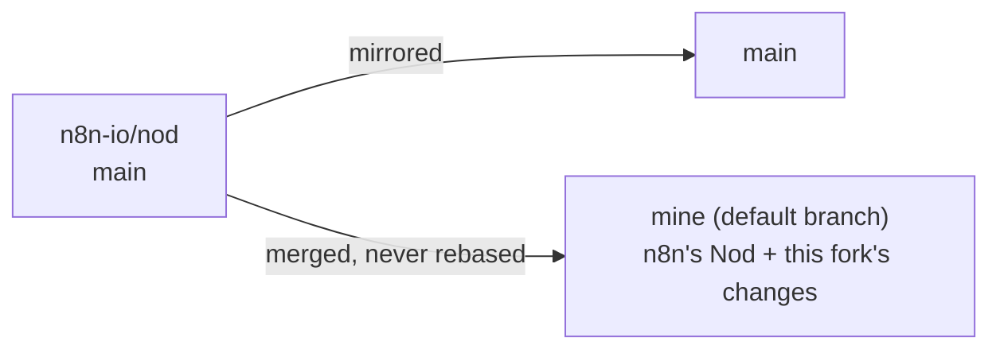

# Nod, with task chats and job search

[](https://github.com/n8n-io/nod)
[](https://github.com/mohamed0s/nod/releases/latest)
[](https://github.com/mohamed0s/nod/blob/mine/LICENSE)

A community fork of [Nod](https://github.com/n8n-io/nod), the open source personal agent from the team behind n8n. Nod has its own computer and browser, runs errands on real websites, runs on your machine with the model you choose, and asks before it acts for you.

This fork follows n8n's `main` closely and adds a few changes on top. Everything else works as in n8n's Nod, so [n8n's README](https://github.com/n8n-io/nod#readme) and the [Nod docs](https://nod.n8n.io/docs/) cover it.

> [!NOTE]
> This fork isn't made or supported by n8n. Before you report a bug to n8n, check that it also happens in [n8n's own Nod](https://github.com/n8n-io/nod/releases/latest).

## What this fork adds

| Change                        | What you get                                                                                                                                                                                                                                                                                                                                                                                                                                                                                                                                                                                                                                                                                                                                                                                                                                                                                                                                                                                                                                                                                                                                                                                                                                                                                                                                                                                                                                                                                                                                                                                                                                                                                                                                                                                                                                                                                                           |
| ----------------------------- | ---------------------------------------------------------------------------------------------------------------------------------------------------------------------------------------------------------------------------------------------------------------------------------------------------------------------------------------------------------------------------------------------------------------------------------------------------------------------------------------------------------------------------------------------------------------------------------------------------------------------------------------------------------------------------------------------------------------------------------------------------------------------------------------------------------------------------------------------------------------------------------------------------------------------------------------------------------------------------------------------------------------------------------------------------------------------------------------------------------------------------------------------------------------------------------------------------------------------------------------------------------------------------------------------------------------------------------------------------------------------------------------------------------------------------------------------------------------------------------------------------------------------------------------------------------------------------------------------------------------------------------------------------------------------------------------------------------------------------------------------------------------------------------------------------------------------------------------------------------------------------------------------------------------------- |
| **Each task is its own chat** | A chat list beside **Main**, with **New chat** and one chat per task, grouped into Working, Needs you and Done. A task chat shows only its own messages, live browser and Stop, and sees only its own history. Rename or close any chat. On Telegram, each task gets its own topic. Memory, rules, Vault, files and schedules stay shared. [Tasks](https://github.com/mohamed0s/nod/blob/mine/docs/src/content/docs/use/tasks.md) · [Telegram topics](https://github.com/mohamed0s/nod/blob/mine/docs/src/content/docs/use/channels.mdx#telegram-topics)                                                                                                                                                                                                                                                                                                                                                                                                                                                                                                                                                                                                                                                                                                                                                                                                                                                                                                                                                                                                                                                                                                                                                                                                                                                                                                                                                               |
| **Job search**                | A **Jobs** page keeps your CVs (one marked main), the job profile Nod drafts from it, and your referral message templates, with right-to-left text and greetings for the time of day. Nod finds jobs with [career-ops](https://github.com/career-ops-hq/career-ops) scans, public Telegram channels and job-alert emails and lists each one once on a **Postings** tab, and the **Job radar** messages you the new ones worth a look every morning at 07:30. A **Companies** tab shows each company's postings and the people you invited there, filtered by who is waiting to accept, to be asked or to reply, and which companies are no luck. For every accept, Nod fills in your template, tailors it once with its small model and sends it to you on Telegram, ready to paste, and it paces invites in waves of 5, up to 10, within your daily and weekly limits. Ticking **No luck, apply here** opens one apply chat for that company. **Job mail** has Nod's server read the Gmail account linked to your LinkedIn every 30 minutes for accepts, replies and company emails, which it labels interview, rejection or other, and pings you once per email; follow-ups come due after 3 days without a reply, and a **Weekly job report** page shows what leads to replies. When a company runs out of chances, Nod can open an apply chat on your standing rule, apply on the company's own careers site with a tailored CV, and ask before it first enters your details on any site and before the final Submit. A browser helper you install separately can pair on the **Helper** tab and log invites and show who accepted, through its own signed routes on this computer. [Job search](https://github.com/mohamed0s/nod/blob/mine/docs/src/content/docs/use/job-search.md) · [Paired helper](https://github.com/mohamed0s/nod/blob/mine/docs/src/content/docs/use/job-search.md#a-paired-browser-helper) |
| **Pages**                     | A **Pages** tab keeps the trackers, dashboards and reports Nod makes as living HTML pages, and a schedule can refresh one every morning instead of sending a new file each time. Each page keeps its last 10 versions. Pages run sandboxed with no network; a click opens only the public `https://` links written in the page itself, in a new tab. Keep any HTML file from chat with **Keep in Pages**. [Pages](https://github.com/mohamed0s/nod/blob/mine/docs/src/content/docs/use/pages.md)                                                                                                                                                                                                                                                                                                                                                                                                                                                                                                                                                                                                                                                                                                                                                                                                                                                                                                                                                                                                                                                                                                                                                                                                                                                                                                                                                                                                                       |
| **Model and agent per chat**  | Each chat runs on its own model: pick it in the chat's header, before a New chat's first message, or say "use … for this chat". Without one it uses your model from Settings. Turn any chat into a named agent with a one-line purpose and instructions Nod follows for focus, tone and method; they never give permission, and a change to an agent always shows you the exact new text and needs your own words. Agents keep their own group in the chat list and survive a conversation reset, and a schedule can run as an agent, with its instructions and, if you choose, its model. An agent can keep its own memory (or its own plus the shared one) while facts about you always stay in shared memory, and can be limited to the connected apps and skills you choose. **Main works as your chief of staff:** it sends your exact request to a named agent, reads its results as data, creates agents only on your words, and stops a stuck or costly agent at fixed limits and tells you; it can never answer an agent's question for you. [Choose the model for a chat](https://github.com/mohamed0s/nod/blob/mine/docs/src/content/docs/use/tasks.md#choose-the-model-for-a-chat) · [Agents](https://github.com/mohamed0s/nod/blob/mine/docs/src/content/docs/use/agents.md)                                                                                                                                                                                                                                                                                                                                                                                                                                                                                                                                                                                                                              |
| **Live desktop development**  | `pnpm run desktop:dev` runs the desktop app from your checkout and follows your edits: web changes are rebuilt and the window reloads, and server changes restart the engine behind the open window once no reply or task is running. The terminal says when a change needs a new runtime or an app restart. [Edit while it runs](https://github.com/mohamed0s/nod/blob/mine/docs/src/content/docs/deploy/desktop-app.mdx#edit-while-it-runs)                                                                                                                                                                                                                                                                                                                                                                                                                                                                                                                                                                                                                                                                                                                                                                                                                                                                                                                                                                                                                                                                                                                                                                                                                                                                                                                                                                                                                                                                          |
| **Windows scripts**           | Scripts in `scripts\windows` install Nod, for the source run or the desktop app run from your checkout, and start, stop, back up, wake and update it. Nod starts at every Windows sign-in, backs itself up every night, can wake the PC for morning schedules, and takes n8n's updates with one command. Another script moves a source install's chats, logins and files into the desktop app. [Move a source install](https://github.com/mohamed0s/nod/blob/mine/docs/src/content/docs/deploy/move-to-desktop.mdx)                                                                                                                                                                                                                                                                                                                                                                                                                                                                                                                                                                                                                                                                                                                                                                                                                                                                                                                                                                                                                                                                                                                                                                                                                                                                                                                                                                                                    |
| **Fork releases**             | A GitHub Actions workflow builds and publishes a Windows installer each time the fork takes in an n8n release. Apps installed from it update themselves from this fork's releases, never from n8n's. [How installed apps update](https://github.com/mohamed0s/nod/blob/mine/docs/src/content/docs/contribute/desktop-releases.mdx#how-installed-apps-update)                                                                                                                                                                                                                                                                                                                                                                                                                                                                                                                                                                                                                                                                                                                                                                                                                                                                                                                                                                                                                                                                                                                                                                                                                                                                                                                                                                                                                                                                                                                                                           |
| **Private by default**        | The Windows install script turns off usage data (`NOD_ANALYTICS_ENABLED=false`) and conversation traces (`NOD_TRACES_URL=`) for the source run. The desktop app run from your checkout sends no usage data either.                                                                                                                                                                                                                                                                                                                                                                                                                                                                                                                                                                                                                                                                                                                                                                                                                                                                                                                                                                                                                                                                                                                                                                                                                                                                                                                                                                                                                                                                                                                                                                                                                                                                                                     |

## Install

### Windows app

Download [nod-Setup-x64.exe](https://github.com/mohamed0s/nod/releases/latest/download/nod-Setup-x64.exe) from this fork's [latest release](https://github.com/mohamed0s/nod/releases/latest). It needs Windows 11 x64, WSL 2 and 20 GB of free disk space. The installer isn't code-signed, so Windows SmartScreen asks you to confirm it once.

After that, the app updates itself from this fork's releases, the way n8n's app updates from n8n's. It checks when it starts and every six hours, downloads the new installer in the background, checks it against the release's SHA-256, and offers **Restart to update**. A new release follows each n8n release the fork takes in, so releases can trail the `mine` branch. Each person's data stays on their own computer.

The first release, 0.9.1, can't update itself: it downloads each new installer and refuses it, again and again. If you installed it, install the latest release by hand once.

### From source on Windows 11

You need [Docker Desktop](https://www.docker.com/products/docker-desktop/) installed and started once, [Git](https://git-scm.com/), and about 20 GB free. The install script gets Node.js 24 and pnpm if they're missing.

```powershell
git clone https://github.com/mohamed0s/nod.git
cd nod
powershell -ExecutionPolicy Bypass -File scripts\windows\install.ps1
```

The script:

1. **Checks Node.js and pnpm,** and installs them if they're missing.
2. **Starts Docker Desktop,** if it isn't running.
3. **Creates `.env`,** with a new Vault key and usage data and traces turned off.
4. **Starts Nod at every Windows sign-in,** through the scheduled task `\Nod\start`.
5. **Backs Nod up every night at 03:30,** through the scheduled task `\Nod\backup`. It saves the database, the `.local` folder, and the browser and tools volumes into the `nod-backups` folder next to this one, and keeps the newest 14 (a failed one gets `-failed` added to its folder name and never pushes good ones out). The Vault key isn't saved.
6. **Adds a `nod` desktop shortcut.**
7. **Starts Nod and opens it in your browser.** The first start builds four containers and can take 10 minutes or more.

**Save the `NOD_VAULT_KEY` line from `.env` in your password manager.** Saved logins can't be read without it.

**Morning schedules while the PC sleeps (optional).** Add `-WakeAt 07:20` to the install command. The scheduled task `\Nod\wake` then wakes the PC from sleep at that time and keeps it awake for 90 minutes, starting Nod if it isn't running. It can't wake a PC that's shut down, and wake timers must be allowed in Windows' power options (they are by default).

### From source as the desktop app on Windows 11

This runs the desktop app from your checkout (`pnpm run desktop:dev`) instead of the source run. You get computer use, Nod's own window and tray icon, and it [follows your edits while it runs](https://github.com/mohamed0s/nod/blob/mine/docs/src/content/docs/deploy/desktop-app.mdx#edit-while-it-runs). You need WSL 2, [Git](https://git-scm.com/), and the Windows runtime in the checkout's `windows-runtime` folder (`manifest.json`, `guest.tar.gz` and `bin\docker.exe`, the same files an installed app keeps in `resources\engine\windows-runtime`). Docker Desktop isn't needed.

Pick a profile folder and always give it as the same text. It holds the app's profile, and Nod's private computer is a WSL distribution named after it. Run the script from the checkout the app should run from:

```powershell
git clone https://github.com/mohamed0s/nod.git
cd nod
powershell -ExecutionPolicy Bypass -File scripts\windows\install.ps1 -Desktop D:\Nod\desktop
```

The script:

1. **Checks Node.js and pnpm,** and installs them if they're missing.
2. **Gives your Windows user full control of the profile folder.** The app needs it on drives where users only have Modify.
3. **Installs the packages and Electron, and builds the web app once.** Electron's download cache goes in `electron-cache` next to the checkout, so it stays on the same drive.
4. **Starts the app at every Windows sign-in,** through `\Nod\start`, which runs `scripts\windows\desktop-start.ps1`. Each start installs packages again only when a lockfile changed, and logs to `desktop-start.log` in the profile folder.
5. **Backs it up every night at 03:30,** through `\Nod\backup`. It saves the database, the workspace, tools and browser volumes, and the profile files (sessions, Pi settings, attachments, the app identity, `settings.json`, `profile.json` and preferences) into `nod-backups` next to the checkout, and keeps the newest 14. It works while Nod is open. A backup that fails keeps its folder with `-failed` added to the name, so you can read its `backup.log`; failed ones never push good ones out. Only your Windows user, SYSTEM and Administrators can open a backup, and each one has a `README.txt` that says what's inside.
6. **Adds a `Nod` desktop shortcut** in place of the `nod` one. It starts Nod, or shows it if it's running.
7. **Starts Nod.** If it's already running from that folder, it keeps running.

The app keeps its own Vault key in `settings.json`, protected by your Windows user, so the script creates no `.env`. `-WakeAt 07:20` works as above. Leave **Open at login** off in Nod's settings: the scheduled task starts it. To bring your source install's chats, logins and files along first, see [Move a source install into the desktop app](https://github.com/mohamed0s/nod/blob/mine/docs/src/content/docs/deploy/move-to-desktop.mdx).

### From source on macOS or Linux

The fork's changes aren't tied to Windows, but the fork is only tested there, and the Windows scripts don't apply. Follow n8n's [Install from source](https://nod.n8n.io/docs/get-started/install-from-source/) with this fork's address:

```sh
git clone https://github.com/mohamed0s/nod.git
cd nod
corepack enable
pnpm start
```

## Free models to start with

Nod runs on the model you choose ([Models](https://nod.n8n.io/docs/connect/models/)). Two services give you an API key for free models, enough to try Nod or to run light background work:

| Service       | Get a key                                                                                                                                                                                                         | Connect it in Nod                                                                                                                 |
| ------------- | ----------------------------------------------------------------------------------------------------------------------------------------------------------------------------------------------------------------- | --------------------------------------------------------------------------------------------------------------------------------- |
| NVIDIA        | Sign in at [build.nvidia.com](https://build.nvidia.com/), verify your phone number, then select **Get API Key**                                                                                                   | **Settings → Models → Add connection → NVIDIA**, then paste the key. Nod loads NVIDIA's list of hosted models                     |
| AMD Token Lab | Join the free [AMD AI Developer Program](https://www.amd.com/aidevprogram), then get a key on [Token Lab](https://notebooks.amd.com/tokenlab), one of its [member perks](https://developer.amd.com/member-perks/) | **Settings → Models → Add connection → OpenAI-compatible**, with the server address `https://api.tokenlab.amd.com/v1` and the key |

Free keys come with limits. Each service caps how many requests you send a minute (NVIDIA's free tier allows about 40; your account page shows yours), and one big job can hit the cap: reading a full inbox sends one safety check per email. Use a paid connection for heavy schedules, and set up [backup models](https://nod.n8n.io/docs/connect/models/#backup-models). Free tiers can also have their own data-use terms, so read them before you send private material.

## Use the job search

Nod finds and scores jobs, keeps count of who you invited where, drafts each referral message and applies on companies' own careers sites. You do everything on LinkedIn yourself, and Nod asks you before it sends anything in your name. Open **Jobs** in the sidebar: its tabs are **Postings**, **Companies**, **CVs**, **Profile**, **Templates**, **Sources** and **Helper**, and a **Get started** list at the top shows what's left to set up.

Before you start:

- **Connect Telegram or WhatsApp** ([Channels](https://github.com/mohamed0s/nod/blob/mine/docs/src/content/docs/use/channels.mdx)) and write to Nod there once. Its pings about accepts and replies arrive in the chat where you last wrote to it.
- **Connect Gmail** on the **Apps** page, for job-alert emails and Job mail.
- **Keep the light model in mind.** Nod suggests your connection's light model for its job schedules, so the daily runs cost less ([Models](https://nod.n8n.io/docs/connect/models/)).

### What runs by itself, and what needs you

| Part                                      | Runs by itself / you            | When                                               | How to turn it on                                            |
| ----------------------------------------- | ------------------------------- | -------------------------------------------------- | ------------------------------------------------------------ |
| Job radar                                 | By itself                       | Every morning at 07:30                             | Say yes when Nod offers it ([step 5](#switch-it-on))         |
| Weekly sweep                              | By itself, inside the Job radar | Once a week                                        | Its switch on **Sources**                                    |
| Job mail: accepts, replies, company mail  | By itself                       | Every 30 minutes, 08:00 to 22:30                   | Choose the mailbox on **Sources**, then say yes              |
| A message for each accept, and its ping   | By itself                       | When someone you invited accepts                   | Save a template on **Templates**                             |
| Waves and no luck                         | By itself                       | Whenever your records change                       | On from the start                                            |
| Apply chats for no-luck companies         | By itself, then you approve     | Within 10 minutes of a company counting as no luck | Send Nod the standing rule ([step 8](#switch-it-on))         |
| Follow-ups due                            | By itself                       | 3 days after you asked someone, with no reply      | On from the start                                            |
| Weekly report                             | By itself                       | Sundays at 19:00                                   | Say yes when Nod offers it ([step 7](#switch-it-on))         |
| Inviting people                           | You                             | On LinkedIn                                        |                                                              |
| Logging invites                           | You, or a paired helper         | As you invite                                      | Tell Nod in chat, or pair a helper ([step 9](#switch-it-on)) |
| Sending each message with your CV         | You                             | After the ping                                     |                                                              |
| **No luck, apply here**                   | You                             | When you give up on referrals at a company         | Tick it on the company                                       |
| Each new careers site and each **Submit** | You                             | When an apply chat asks                            |                                                              |

### What runs by itself

Each part says when it runs, what it does, what it costs, where you see it and how to stop it. Model use shows on **Usage** like any other work.

- **Job radar.** Every morning at 07:30 in your time zone, it reads every source that's on, drops duplicates, gives each new job a short check and fully scores the five best. Then it sends one message: the jobs worth a look, each with its score, company, title and link, then who accepted and waits for your message, the follow-ups due, the replies since yesterday and the companies whose next wave opened. A quiet day sends nothing.
  - **Costs:** one run a day. Short checks are cheap; the five full scores read your CV and each job's page, and cost the most.
  - **See it:** in that message, and on **Postings**, best score first.
  - **Stop it:** pause **Job radar** on the **Scheduled** page.
- **Weekly sweep.** Off at first. When it's on, the Job radar also reads, once a week, every company that Greenhouse, Lever and Ashby list publicly. That brings in many more jobs, so the run takes a while and its short checks cost more. You see the jobs on **Postings**. Turn it off with its switch on **Sources**.
- **Job mail.** Every 30 minutes from 08:00 to 22:30, Nod's server checks the Gmail account you linked to LinkedIn for LinkedIn's "accepted your invitation" and new-message emails, and for emails from companies you applied to or asked someone at. It checks each sender, matches the emails to your records without a model, moves people to **Accepted** or **Replied**, and has its small model label each company's email interview, rejection or other. It never replies to anything.
  - **Costs:** no model call when no new mail arrived. Otherwise one short run, plus one small-model label for each company email.
  - **See it:** one ping per accept, reply and company email; the statuses, the **Interview**, **Rejected** or **Email reply** badge and the **Replied** filter on **Companies**; and the last run under **Job mail** on **Sources**.
  - **Stop it:** pause **Job mail** on the **Scheduled** page.
- **A message for each accept.** When someone you invited becomes **Accepted**, from Job mail, a helper or your own words, Nod fills in your template for them, its small model adjusts the wording once (for example Arabic forms for a woman), and Nod sends you the message on Telegram or WhatsApp, ready to copy, with **Open profile** and **Message** links. Your first 10 messages also say what it changed and why. Nod sends nothing to the person.
  - **Costs:** filling in the template uses no model; tailoring is one small-model request.
  - **See it:** in the ping, under the person on **Companies**, with **Copy**, **Edit**, **Remake** and **Language**, and in a paired helper.
  - **Stop it:** there's no switch. It follows every accept of someone you logged.
- **Waves and no luck.** Nod's server keeps count, with no model. It suggests inviting 5 people at a company at a time, up to 10, within your daily and weekly invite limits. Someone has had their chance after 7 days without accepting, 5 days without answering your request, or a decline, and the next wave opens when everyone so far has had theirs. A company counts as no luck once all 10 had their chance and nobody referred you. You see it in each company's wave line, the **Next wave** and **No luck** filters, the Job radar and a paired helper. **Keep trying** keeps one company open, and the numbers are on **Profile**.
- **Apply chats.** With the [standing rule](#switch-it-on) in place, when a company with open jobs comes to count as no luck, Nod opens one chat for it, **Apply for a company that counts as no luck**, for at most 3 companies a day. It checks every 10 minutes and soon after your records change, and during your quiet hours it waits for them to end. For each job, at most 2 a company, it checks that you haven't applied already, finds the job on the company's own careers site, makes a tailored CV from your main CV, fills in the form and stops before the final **Submit**. Without the rule, it only picks the jobs, tells you once what the rule would let it do, and stops.
  - **Costs:** the big one. An application often takes 100,000 to 300,000 tokens, and a long one reaches the [task check-in](https://github.com/mohamed0s/nod/blob/mine/docs/src/content/docs/use/spending.md#task-check-ins).
  - **See it:** the chat in your chat list (and in its own Telegram topic when [topics](https://github.com/mohamed0s/nod/blob/mine/docs/src/content/docs/use/channels.mdx#telegram-topics) are on), **Apply chat: started automatically** on the company, and **Applied on** with the date and the site's reference on the posting.
  - **Stop it:** set **Apply chats Nod starts by itself a day** to 0 on **Profile**, tell Nod "Pause preparation", or select **Keep trying** on a company.
- **Follow-ups due.** When 3 days pass after you asked someone for a referral without a reply, they show **Follow-up due**, on their company and in the next Job radar. It comes once per person, with no model. Nod has no follow-up template: write it yourself, or ask Nod in chat for a draft. Then select **Followed up**, or **Dismiss**. Change the days on **Profile**.
- **Weekly report.** Every Sunday at 19:00, Nod updates the **Job search weekly** page in **Pages** and sends you a short summary: the week's invites, accepts, requests, replies, referrals, applications and company replies, and what leads to replies, by template version, message language and company. The numbers are counted from your records, never estimated. It costs one light-model run a week. Pause **Weekly job report** on the **Scheduled** page to stop it.

### What needs you

- **Everything on LinkedIn.** Nod never opens LinkedIn. You send each invite, paste each message, attach your main CV and follow up. **Open profile** and **Message** open LinkedIn in a new tab for you.
- **Telling Nod what happened,** when Job mail or a paired helper doesn't see it. In chat or on Telegram: "I invited Sam Example at Example Co" with their profile link, "I asked Sam Example", "Sam Example referred me". Or change the status next to the person on **Companies**, for example to **Asked** after you send your request.
- **Yes or no to Nod's offers:** the Job radar, the Telegram channels it suggests, Job mail and the weekly report. It offers each once.
- **Postings:** **Shortlist** or **Skip** what you've read, and select **I applied** when you applied yourself.
- **No luck, apply here,** when you give up on referrals at a company before Nod would. Your tick opens its apply chat at once, without the standing rule.
- **In an apply chat:** your yes to each new careers site (**Apply at** _company_ **on** _site_**?**) before Nod enters anything there, any required answer your CV and profile don't give, a CAPTCHA, and your yes to each final **Submit**. When a site signs in only with Google or keeps showing a CAPTCHA, Nod sends you the answer sheet and the tailored CV: finish in your own browser, then select **I applied** on the posting.
- **Company emails:** Nod tells you about each one; you read and answer it yourself.

### Switch it on

Do these once, in this order. Each step names the button, or the words to send Nod in chat, on Telegram or on WhatsApp.

1. **CV.** On **CVs**, select **Add a CV** and choose a PDF or Word file, or send the file on Telegram with "This is my CV". Nod converts it in a new chat, **Convert the CV I just added for job search**, drafts your profile from it and asks at most one short question. Your first CV is the main one; **Mark as main** switches it.
2. **Profile and programmes.** On **Profile**, check **Name in messages**, **Introduction**, **Target roles** and **Regions**. Add what you're applying to under **Programmes and tracks**, one per line, such as `Example Graduate Programme: Data, Software`. Pick a **Message language**, and add exceptions under **Language by country**, such as `CA = fr-CA`. Select **Save profile**. Or tell Nod: "I'm applying to the Example Graduate Programme, tracks Data and Software."
3. **Templates.** On **Templates**, pick a **Language** and write your referral message. Select a field under it to insert `{greeting}`, `{first_name}`, `{company}`, `{programme}`, `{track}`, `{role}`, `{my_name}` or `{my_intro}`. Fill in **Morning greeting**, **Afternoon greeting** and **Evening greeting**, or only **Any time**. Use **Add a language** for each other language, then **Save templates**.
4. **Sources.** On **Sources**, **Company career sites and job boards** and **Job-alert emails** are on from the start; turn on **Weekly sweep of Greenhouse, Lever and Ashby** if you want it. Add public Telegram channels under **Add a channel**.
5. **Job radar.** Nod offers it when it drafts your profile; say yes. If you missed it, send: "Set up the Job radar: every morning at 07:30, look for new jobs and message me the ones worth a look."
6. **Job mail.** On **Sources**, under **Job mail**, choose the **Gmail account linked to LinkedIn**. Nod never guesses it. Nod offers the schedule once in chat, after Gmail is connected and you've invited someone; say yes, or send: "Check my job mail every 30 minutes."
7. **Weekly report.** Nod offers it once, after your first referral request; say yes, or send: "Make me a weekly job report every Sunday evening."
8. **The standing rule for applying.** Send it once:

   > When a company is marked no luck, apply to its matching jobs on its own careers site with a tailored CV. Ask me before the final Submit.

   Without it, an apply chat that Nod starts by itself only picks the jobs and stops. Reply in that chat, or tick **No luck, apply here**, to let it go on there.

9. **The helper (optional).** Pair a browser helper on the **Helper** tab; its own guide explains it.
10. **Limits.** On **Profile**: **Invites a day** (15) and **Invites a week** (80), **No luck after days without an accept** (7) and **No luck after days without a reply** (5), **Follow up after days without a reply** (3), **People in a wave** (5) and **People a company, at most** (10), **Apply chats Nod starts by itself a day** (3; 0 turns it off) and **Applications a company, at most** (2). Select **Save profile**. When you ask Nod in chat instead, it changes invite limits, no-luck days, waves and apply limits only when your words ask for exactly that change, and asks you first otherwise.

### A day of job hunting

| When                               | Nod                                                                                                                                                                                                                            | You                                                                     |
| ---------------------------------- | ------------------------------------------------------------------------------------------------------------------------------------------------------------------------------------------------------------------------------ | ----------------------------------------------------------------------- |
| Every morning at 07:30             | The **Job radar** sends one message: new jobs worth a look, people who accepted and wait for your message, follow-ups due, replies since yesterday and companies whose next wave opened.                                       | Read it. **Shortlist** or **Skip** on **Postings**.                     |
| While you're on LinkedIn           | A paired helper logs each invite you send and shows how many more to invite at that company today, within your limits. Without one, tell Nod who you invited.                                                                  | Send the invites.                                                       |
| Every 30 minutes, 08:00 to 22:30   | **Job mail** reads your LinkedIn Gmail account for accepts, replies and company emails, updates the people and labels each company email.                                                                                      | Nothing, unless Nod asks who someone is.                                |
| When someone accepts               | Nod fills in your template for them, tailors it once and sends it to you on Telegram with **Open profile** and **Message**.                                                                                                    | Paste it, attach your main CV, send it, and mark them **Asked**.        |
| When a company emails you          | Nod pings you once per email and shows the label on the company. It never replies.                                                                                                                                             | Answer the ones that matter.                                            |
| 3 days without a reply             | The person shows **Follow-up due**, on **Companies** and in the next morning's message.                                                                                                                                        | Follow up on LinkedIn, then select **Followed up**.                     |
| When a company runs out of chances | Once all 10 people had their chance and nobody referred you, the company counts as no luck. With your rule, Nod opens one apply chat (up to 3 a day), finds the job on the company's own careers site and makes a tailored CV. | Say yes to the site, fill any blanks, then yes or no to the **Submit**. |
| Sundays at 19:00                   | The **Job search weekly** page in **Pages** shows the week and what leads to replies, by company, language and template version.                                                                                               | Glance at it.                                                           |

Your CVs, profile and templates stay in Nod's storage on your computer, never in the code. Everything else, including what each part sends to a model and who can change which record, is in [Job search](https://github.com/mohamed0s/nod/blob/mine/docs/src/content/docs/use/job-search.md).

## Use Pages

Ask Nod for a page in chat, for example "make a page that tracks my reading list and update it every morning". For the schedules you already have, try "for each of my schedules, make a page and keep it current". Nod builds the page and puts it on the **Pages** tab. When you ask for a change, or a schedule runs, it updates the same page instead of sending a new file. To keep an HTML file Nod sent in chat, open it and select **Keep in Pages**.

On the **Pages** tab, select a page to see it:

- **History** keeps its last 10 versions, and **Make it the current version** brings an earlier one back.
- **Rename**, **Archive** and **Delete** do what they say. Nod can't update an archived page until you unarchive it.
- **Open chat** or **Open schedules** goes to whatever publishes the page.

Pages can't reach the internet. A click opens only the public `https://` links written in the page itself, in a new tab. The details are in [Pages](https://github.com/mohamed0s/nod/blob/mine/docs/src/content/docs/use/pages.md).

## Day to day on Windows

| To                         | Source run                                                                  | Desktop app                                                                                         |
| -------------------------- | --------------------------------------------------------------------------- | --------------------------------------------------------------------------------------------------- |
| Open Nod                   | Double-click the `nod` shortcut, or go to `http://localhost:4310`           | Double-click the `Nod` shortcut, or click Nod's tray icon                                           |
| Stop Nod                   | `powershell -File scripts\windows\stop.ps1`                                 | **Quit Nod** in the tray menu. `stop.ps1` asks Nod to quit the same way and never force-closes it   |
| Start Nod again            | `Start-ScheduledTask -TaskPath '\Nod\' -TaskName start`, or sign out and in | The `Nod` shortcut, the same task, or sign out and in                                               |
| Get n8n's latest changes   | `powershell -ExecutionPolicy Bypass -File scripts\windows\update.ps1`       | The same. Nod keeps running and follows the change; the script says when to quit and start it again |
| See what happened at start | `.local\windows-start.log`                                                  | `desktop-start.log` in the profile folder (the one before is `desktop-start.prev.log`)              |
| Back up now                | `powershell -ExecutionPolicy Bypass -File scripts\windows\backup.ps1`       | `powershell -ExecutionPolicy Bypass -File scripts\windows\backup.ps1 -Desktop D:\Nod\desktop`       |
| Stop the morning wake      | `Unregister-ScheduledTask -TaskPath '\Nod\' -TaskName wake -Confirm:$false` | The same                                                                                            |

## How this fork stays in step with n8n



- **`main`** is an exact copy of n8n's `main`.
- **`mine`**, the default branch, is n8n's Nod plus this fork's changes, one small commit per change.
- **n8n's updates are merged into `mine`, never rebased,** so its history is never rewritten and `git pull` always works.
- **`scripts\windows\update.ps1` does it all:** it stops Nod, merges n8n's latest `main`, pushes both branches to your GitHub copy if you have one, and starts Nod again. If n8n's changes clash with the fork's, it changes nothing and says so. With the desktop app it leaves Nod running, because the app follows server and web changes by itself, and it says when a package, desktop app or runtime change needs a restart.
- **Changes that could help everyone are offered to n8n.** Backup models ([#1361](https://github.com/n8n-io/nod/pull/1361)), the busy model check ([#1374](https://github.com/n8n-io/nod/pull/1374)) and the connection buttons fix ([#1360](https://github.com/n8n-io/nod/pull/1360)) started in this fork and are now part of n8n's Nod. Task chats are proposed in [Discussion #1359](https://github.com/n8n-io/nod/discussions/1359).

## Build a Windows installer

n8n's own release workflow runs only in n8n's repository: it needs their paid build machines and signing keys. This fork has its own, **Fork Windows release**, and it runs by itself.

1. **Each n8n release starts it.** n8n marks a release by changing `desktop/release.json`. When `scripts\windows\update.ps1` pushes a merge that changes it to `mine`, the workflow builds a release from `mine`. If the fork already has a release for that n8n version, it builds nothing and says which release covers it.
2. **Versions follow n8n's, a step above them.** n8n's 0.9.1 becomes 0.9.200, and another build of it 0.9.201. n8n's 0.9.2 becomes 0.9.300, and n8n's 0.10.0 becomes 0.10.100. A version is never one of n8n's own, and the run stops with an error if it can't pick one.
3. **It builds and checks the installer** on GitHub's machines, then publishes `nod-v<version>` as the fork's latest release. The runtime, about 1.5 GB, is rebuilt when its inputs change and by the first build of each week (from Monday, UTC). Otherwise it's copied from an earlier release, so installed apps download only the new installer. If the copied runtime fails its checks, the run builds a fresh one.
4. **To build one by hand**, open **Actions → Fork Windows release → Run workflow**. It runs only on `mine`. Leave the version empty to number it as above, or enter one in the same range for the current n8n version (0.9.200 to 0.9.299 for n8n's 0.9.1) that's higher than every `nod-v` tag on the fork.

Runs never overlap. A new run waits for the running one, and a newer waiting run replaces an older one. To share a build, send the release link.

The installers aren't code-signed, so installed apps trust this fork's GitHub releases. Each installer's SHA-256 is checked against the release, which protects the download on its way to the PC, and an installer with a broken signature or another publisher's is still refused. But anyone who can publish a release on this fork can ship code to every install. Signing with a key kept in a protected GitHub environment that needs a reviewer's approval would separate uploading a file from shipping code; this fork accepts not having that. See [How installed apps update](https://github.com/mohamed0s/nod/blob/mine/docs/src/content/docs/contribute/desktop-releases.mdx#how-installed-apps-update).

## Troubleshooting

- **"Could not resolve host" or "no such host" during the first start.** Docker Desktop's built-in name lookup can drop requests on some networks.
  1. In Docker Desktop, open **Settings → Docker Engine**.
  2. Add `"dns": ["1.1.1.1", "8.8.8.8"]`.
  3. Apply and restart, then start Nod again.
- **C: is nearly full.** In Docker Desktop, open **Settings → Resources → Advanced**, and move the disk image location to another drive before the first start.

## Credits and license

Nod is made by [n8n](https://n8n.io) and licensed under the [Apache License 2.0](https://github.com/mohamed0s/nod/blob/mine/LICENSE). This fork's changes use the same license. Bundled third-party terms are in [NOTICE](https://github.com/mohamed0s/nod/blob/mine/NOTICE).

The job search uses [career-ops](https://github.com/career-ops-hq/career-ops) by Santiago Fernández de Valderrama and contributors, under the MIT license. The workspace image installs a pinned commit (`abefa6dbdb57fd2971c0d24ec563f24de57477ca`, version 1.39.0) and checks its SHA-256; see [`install-career-ops.sh`](https://github.com/mohamed0s/nod/blob/mine/jobs/workspace/install-career-ops.sh).

This fork isn't affiliated with or endorsed by n8n GmbH.
