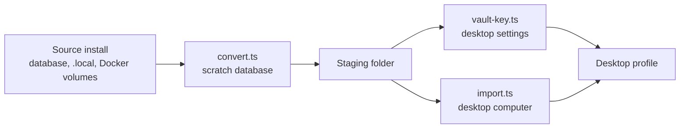

import { Steps } from '@astrojs/starlight/components';

This page moves a Windows source install (`pnpm start`, set up with `scripts\windows\install.ps1`) into a desktop app profile that you run with `pnpm run desktop:dev`. Your source install stays as it was, so you can go back to it.

The two installs use different owner IDs. The source owner is always `local-development`, while the desktop profile has its own ID in `profile.json`. Saved logins and connections are encrypted for one owner, so a plain copy wouldn't open. The move rewrites every place that names the old owner and keeps the same Vault key.



## What moves

| Kept                                                                      | How                                                            |
| ------------------------------------------------------------------------- | -------------------------------------------------------------- |
| Chats, tasks, schedules, memory, rules, job tables, usage                 | The database, with every owner ID changed to the desktop owner |
| Saved logins and cards, model connections, Telegram and WhatsApp settings | Decrypted and encrypted again for the desktop owner, same key  |
| App connections                                                           | The same app identity, encrypted again for the desktop owner   |
| Pi sessions                                                               | Copied, with each session pointed at its new folder            |
| Attachments                                                               | Copied into the desktop owner's folder, with their paths fixed |
| Workspace files, installed tools, browser sign-ins                        | Copied into the desktop computer's volumes                     |
| Telegram polling position                                                 | Kept, so old messages aren't answered again                    |

Access keys, logs, diagnostics, speech model downloads and analytics IDs stay behind. The desktop app makes its own.

## Before you start

- Run the commands in PowerShell from your source `nod` folder, after `pnpm --dir desktop install`.
- Keep Docker Desktop running. The source data and a short-lived scratch database use it.
- Have free space for about twice your `.local` folder and Docker volumes on the drive that holds the staging folder.
- Pick a desktop folder and keep it in one variable. Every step and every later launch must use exactly the same text, including the drive letter's case.

  ```powershell
  $env:NOD_DESKTOP_USER_DATA = 'D:\Nod\desktop'
  ```

## Move it

<Steps>

1. Open the desktop app once with that folder, wait until setup shows, then choose **Quit Nod** from the tray. This creates the profile, its private computer and its database.

   ```powershell
   pnpm run desktop:dev
   ```

2. Stop the source install and turn off its autostart. Two Nods must never poll the same Telegram bot.

   ```powershell
   scripts\windows\stop.ps1
   Disable-ScheduledTask -TaskPath '\Nod\' -TaskName start, wake, backup
   ```

3. Start only the source database and back it up. The backup folder's `database.dump` is the input for the next step.

   ```powershell
   docker compose start postgres
   scripts\windows\backup.ps1 -Destination D:\Nod\move\backup
   docker compose stop postgres
   ```

4. Convert. Choose a new, empty `--out` folder. Nothing in the source changes.

   ```powershell
   pnpm exec tsx scripts\windows\desktop-move\convert.ts --dump D:\Nod\move\backup\<stamp>\database.dump --source-root .local --env .env --user-data $env:NOD_DESKTOP_USER_DATA --out D:\Nod\move\staging
   ```

5. Give the desktop profile your source Vault key. The old desktop settings are kept as `settings.json.before-move`.

   ```powershell
   pnpm exec tsx scripts\windows\desktop-move\vault-key.ts --staging D:\Nod\move\staging --env .env
   ```

6. Check the import plan, then import.

   ```powershell
   pnpm exec tsx scripts\windows\desktop-move\import.ts --staging D:\Nod\move\staging --dry-run
   pnpm exec tsx scripts\windows\desktop-move\import.ts --staging D:\Nod\move\staging
   ```

7. Open the desktop app with the same `NOD_DESKTOP_USER_DATA`.

</Steps>

Convert refuses to run while the source install is running. The Vault key and import steps refuse while the desktop app is open.

## What convert checks

Convert restores the dump into a scratch database and works there in one transaction.

1. It opens every saved secret with your Vault key and the source owner. If one doesn't open, it stops and names the table, before anything is written.
2. It encrypts each secret again for the desktop owner, checks that it opens, and checks that it no longer opens for the source owner.
3. It replaces every value that is exactly the old owner ID, in any column of any table, including values inside JSON and lists. It fixes attachment paths, clears lock records and removes the old Vault key check, which the desktop app makes again.
4. It searches every text and JSON column for the old owner, its hash and the source data folder. Your own messages, memory notes, task text and tool output can mention them, so those columns are allowed and reported. Any other match stops the move and names the column. If that column holds only text you or Nod wrote, add `--allow-content <schema.table.column>` and run convert again.

The staging folder holds `plan.json`, the converted `database.dump`, the profile files and the volume archives. A folder without `plan.json` is unfinished, and import refuses it.

Import replaces the desktop database in one transaction, then checks each table's row count against the plan. If import stops partway, run it again.

## Go back to the source install

The source install isn't changed. To use it again, quit the desktop app, then turn its autostart back on and start it.

```powershell
Enable-ScheduledTask -TaskPath '\Nod\' -TaskName start, wake, backup
Start-ScheduledTask -TaskPath '\Nod\' -TaskName start
```

To start the desktop profile over, choose **Remove all data** in the desktop app, or quit it and delete the desktop folder and its private computer.

## Related resources

- [Desktop app internals](/deploy/desktop-app/)
- [Vault](/trust/vault/)
- [Install from source](/get-started/install-from-source/)
