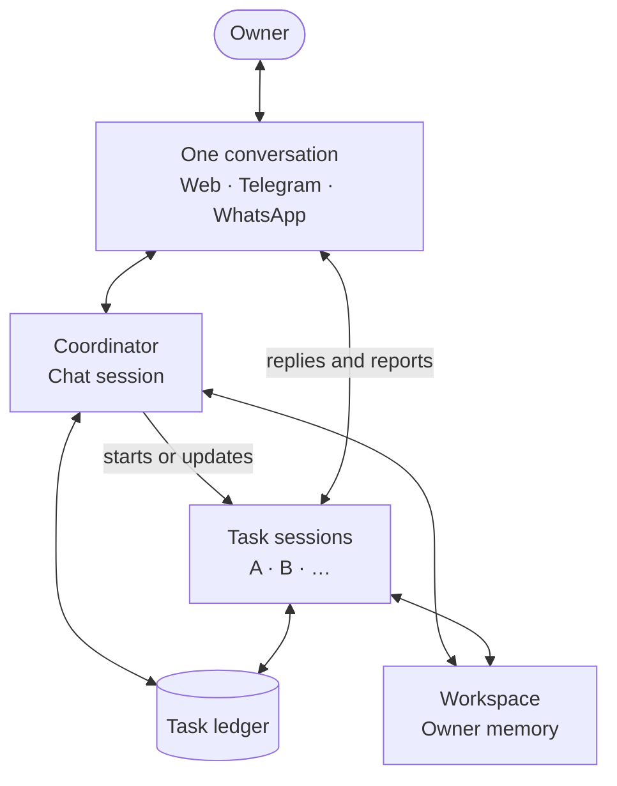

Nod has one conversation per owner. The main chat session coordinates work. Each independent task gets a saved session that reports to the same conversation.

Quick answers, simple lookups, status questions and short work in your connected apps, such as reading, drafting, sending, forwarding or deleting a few emails, stay in chat. Other substantial work, including multi-step work that can finish in one sitting, an outside wait, or your explicit request to track work starts a saved task, and Nod chooses that itself without asking you for an execution mode. A new independent request while other work runs starts its own task; corrections and related updates go to the existing task. The chat itself has no browser, sign-in, payment or computer tools, so work that needs the browser, a login, a payment or a desktop app always runs in a task with its own context, browser and questions; web lookups stay in chat. A new message in a chat or task closes that session's older open questions; other tasks keep theirs.

## The architecture



The conversation is the owner's view of the work. The coordinator assigns work and routes ordinary follow-ups. A task session does the work, asks its own questions and delivers its own results. The coordinator does not rewrite each result through another model call.

Explicit replies go to the selected task before the coordinator runs. The task's message identifies which work the owner is answering. The web app also lets the owner start a task directly with **New chat**, without the coordinator.

## Three separate concepts

| Concept | Purpose                                                   | Lifetime                                                |
| ------- | --------------------------------------------------------- | ------------------------------------------------------- |
| Task    | The goal, completion condition, progress and result.      | Until completed or stopped; its record stays available. |
| Session | The saved Pi history and execution context for that work. | Across turns, questions and owner updates.              |
| Turn    | One execution started by a message, dispatch or resume.   | Until it succeeds, waits, fails or is cancelled.        |

A task can need several turns in the same session. A successful turn does not mean the task is complete. The task calls `finish` after it checks its completion condition. A turn that ends with its final answer, as final text or with `send_message` intent `final`, also closes the task as done when nothing else is planned: no wait, later check or queued owner update. The result is that answer.

Each session runs one turn at a time. Different sessions run in parallel. There is no task limit of three. Browser capacity is a separate resource limit; a task that does not browse does not open a browser.

## One task ledger

The `tasks` table is the source of truth for task state. Task messages, web cards and Telegram status replies show that state; they are not separate task records. The model writes every task message from that state, in the conversation language described in [Agent runtime](/how-it-works/agent-runtime/), even when the task was requested in another language.

| Record        | Owns                                                                                                                                                        |
| ------------- | ----------------------------------------------------------------------------------------------------------------------------------------------------------- |
| `tasks`       | Goal, completion condition, brief, source owner message, session and message links, steps, progress, update revisions, result and when its chat was closed. |
| `turns`       | Execution state, session, task, reply channel and resume links.                                                                                             |
| `messages`    | Owner input, questions, replies and delivered file links.                                                                                                   |
| `turn_events` | Tool and helper activity for the task's activity view.                                                                                                      |
| `model_usage` | Model requests and their cost.                                                                                                                              |

Each turn sees up to 100 tasks of the active conversation, open ones first, then finished ones with their results, newest first. The web chat list shows the same tasks. After a conversation reset in a development build, tasks from the archived conversation stay saved and on the Tasks page, which lists up to 100, open ones first, but leave the turn context.

A model-written task list in the workspace does not replace the ledger. The existing turn queue runs the sessions. The task system does not add another scheduler or cost ledger.

## Start, reply and finish

1. The owner gives the coordinator an independent goal. The coordinator uses `task start` with a title, completion condition, brief and planned steps.
2. One transaction saves the task, posts its first message and queues its first turn. A task started from chat uses its task ID as the session ID. The original owner message stays linked to the task.
3. The worker opens that saved session. The task updates its steps as it works. Text the model writes between tool calls becomes the task's live status: its card shows it, with the website while it browses. It isn't posted, because the task's first message already says what it is doing. Its questions, files, deliberate `send_message` updates and final reply reach the conversation; if it ends without a final reply, its last such text is posted instead. A reply from the owner while the task works gets its answer as a message. Event and schedule runs stay quiet.
4. If the task needs the owner, it asks a question and waits. Other sessions continue.
5. A reply to the task's first message, question, file or result continues that task, even if it finished or stopped. An ordinary message goes to the coordinator, which can forward the exact owner message to selected open tasks. If the latest message is a finished task's result, an explicit retry can reopen that task with its original request, provided the owner started it. Web and desktop match the shared conversation. Chat apps match their own chat. If the target is unclear, Nod asks. In web and desktop, a task working on a message routed this way shows its working dot, title and live status under that message. It takes the place of the chat's own activity line until the task posts a message, finishes or needs the owner. Selecting it opens the task.
6. The task checks its completion condition, shares any result files and calls `task finish`. Its final reply goes directly to its message in the shared conversation.

Each owner update has a revision. The server records delivery at a model boundary. A task cannot finish while an owner update remains queued. A correction closes the old waiting turn, so an old pending approval cannot execute after that correction. Saved setting changes bind that owner-input revision as well as the setting's version. Chat and task work use the same owner-evidence record, so a chat-started task keeps up to five owner chat messages from the 24 hours before it started. A chat started with **New chat** keeps none, because it doesn't come from the main chat. These messages only supply context. Later chat adds no permission. A schedule created or changed by that task retains the exact checked owner inputs and any proposal they answer. Later unrelated chat cannot add permission.

The background observer starts a separate task for an outside action, question, or approval. A stable key for the source record and change returns the existing task. The task keeps event authority and the normal Trust check. Its wait leaves the observer free. A task started during quiet hours begins when they end; its first turn stays queued until then.

A schedule or other event session can also create a task record for its work. It keeps its existing session.

## Start a task with New chat

**New chat** in the web app starts a task without the coordinator:

1. The owner's message is saved as a `user` turn in a new session. The server marks it as background work for that session.
2. The same transaction saves a task whose ID is that session ID. Its title starts as the message's first line, its brief is the message, and its source owner message is that message. It has no completion condition, no first task message and no steps until the task writes them.
3. The turn runs as that task. When it ends with its final answer, the task closes as done, like any task.
4. After the first turn that succeeds and isn't withdrawn, the memory model writes a title of 2 to 5 words in the owner's language, once per chat, in one bounded request. It reads the chat's first owner message that still counts, so a request that failed at the provider and was withdrawn isn't used, and that turn's reply. `tasks.title_by` records who named the chat: `line` for the first-line title, `model` once the memory model was asked, `owner` after a rename, `topic` for a chat started in a Telegram topic the owner made, which keeps the topic's name and gets no automatic title. A rename by the owner, from the chat list or the Tasks page, always wins: the model's title is written only while the chat still has no owner title, and a chat the owner renamed never gets one. The title is data for the model, never owner words.

A new chat skips the reading of confirmation replies, the confirmation lookup, task reply targets and waiting questions. Without a reply target, a plain "yes" in Telegram or WhatsApp is read against the latest confirmation in that channel, which can belong to another session. On web, it is read only against confirmations outside task chats, because a message in a task chat always replies to that chat's latest message. In Telegram's General or Main topic, once task topics are in use, it is read only against the latest message Nod delivered in that topic before it, whichever session wrote it, and a later notice there blocks it. "Before" follows Telegram's message ids, which grow across all topics of the private chat, and Nod's send time only when an id is missing. A new chat's "yes" never answers another session's approval or question. A new chat can't carry a reply, a quote or an answer to a card. A new chat started while Stop is catching arriving messages is saved with its turn cancelled and withdrawn, and its task stopped.

## Shared information, separate histories

All sessions use the same workspace for the owner's conversation:

```text
/workspace/<thread ID>/
├── shared/
└── tasks/
    ├── <task A>/
    │   ├── drafts/
    │   └── outputs/
    └── <task B>/
        ├── drafts/
        └── outputs/
```

Task folders organize working files. They are not security boundaries. A task can read another task's output by its path. It must not overwrite another task's working files.

Each session has its own saved Pi transcript. Owner memory is shared and stays outside the sandbox. Sessions load current memory and task state when they start or continue.

Each chat is its own conversation for the model. A turn's recent chat comes only from its own chat: a task's chat reads its own session and the owner messages the main chat forwarded to it with `task reply`, and **Main**, with the schedule, event and observer runs whose messages show there, reads the messages that belong to no task. Recall of older owner messages, memory recall and the owner messages `memory_learn` reads stay in the same chat. `history_search` searches the current chat; with `chats: all` it searches every chat and names the chat of each message from another one, as `chat: "Main"` or the task's title. The main chat still sees every task's state and result in the task ledger. Memory, the owner's rules, Vault, connected apps and schedules are shared by all chats.

Shared storage does not put every change into every active model context. The server delivers addressed owner updates. Tasks read current ledger state and shared files when they need them. Use saved reports and file paths to pass results between tasks; do not depend on another session's private history.

Coordination goes through the main session and ledger. Task sessions cannot forward owner updates to other tasks. They can read shared outputs. `delegate` is different: it runs temporary helpers inside a turn, returns their results to the parent and does not create saved task records.

Shared information does not grant permission. For a task started from chat, the trust check uses its original owner request and owner messages addressed to it. It also keeps up to five owner chat messages from the 24 hours before the task started, as background only; a chat started with **New chat** keeps none. The main chat's check never sees a task chat's messages. The confirmation writer takes its language evidence from the same chat as the turn that asks. Other task reports, files, briefs and memory cannot authorize an outside action. See [Approvals](/trust/approvals/).

## One task across web and chat apps

In web chat, a task has a chip under its first message and a card that opens from the tasks line, with its current work, steps, completion condition, **Reply** and **Stop**. **Scheduled** shows a compact preview for each open and finished task. Expand it for steps, activity, the completion condition and task controls. Activity shows tool and helper events, not private model reasoning. In web and desktop chat, each message the task posts quotes the owner message it belongs to: the latest owner message the task had taken in when it posted, or else the one that started it. Selecting the quote jumps to that message.

The web chat list shows **Main** and one chat per task of the active conversation. A message belongs to the chat of a task when its turn is linked to that task, or when it ran in a session that task owns. Other messages belong to **Main**, including the first message of a task started from chat, which shows as the task's card there. A task's chat shows its own messages after its card, and `GET /api/messages?task=<task ID>` pages through them; `task=main` pages through **Main**. Each message in a task's chat is an explicit reply to the chat's latest message from Nod. It takes the same reply path as a chat-app reply, so it continues the task's session, answers only that task's question or confirmation, and reopens a finished task.

Each chat in the list has an options menu with **Rename** and, once it is done, **Close chat**. Double-click a chat or press F2 on it to rename it in place; Enter or leaving the field saves and Escape cancels. A rename uses `PATCH /api/tasks/:id` with `title`.

Closing a chat sets `tasks.archived_at`, which hides it from the list. Only a finished or stopped task can be closed; closing an open one is refused. A later owner input to the task clears it, so a reopened task shows again. The task's live browser view uses the same task-to-session mapping, through `GET /api/browser?task=<task ID>`.

Telegram shows the task as messages Nod writes. If its first message arrives as one short text message, a quoted progress section in your language updates there without another notification, then is removed when work stops. Other message types keep typing status only; see [While Nod works](/use/channels/#while-nod-works). Each task keeps its own message and reply target. Its questions and result reply to that first message. `/tasks` sends a replyable status message for each open task. Reply with `/status` to inspect it or `/stop` to stop it. Native reply links for text parts and files select the same saved task in Telegram and WhatsApp.

When the Telegram bot has topics on, each task also gets its own topic in the private chat. Nod reads the setting from `getMe` (`has_topics_enabled`) at most every five minutes. Only a task with its own session gets a topic. A message whose turn is linked to such a task goes to its topic; Nod creates the topic with `createForumTopic`, named after the task, once that message is claimed for sending, and `channel_topics` keeps the pairing. When the chat is renamed, by the owner or by its automatic title, Nod renames each of its topics with `editForumTopic`; a refused rename is logged with Telegram's reason and doesn't undo the chat's own rename. `channel_topics.name` keeps the name Nod last gave the topic, so a rename that was refused or came before the topic existed is made before Nod's next message to that topic. A topic without a recorded name, such as one the owner made, takes the chat's current title as its recorded name without being renamed. Everything else goes where the main chat lives: the main chat, the task's start message from the main chat, and a schedule or event run, even when it starts a task that shares the run's session. When Telegram refuses to create the topic, that message goes there too, where it is answered like any main chat message, and the next message tries again. A message in a known topic is an explicit reply to the latest message of that task that Nod delivered in that topic before it, in the same Telegram order, so it continues that task and its "yes", `/status` or `/stop` applies to that task. A later notice in that topic, such as a `/status` answer, keeps a bare "yes" from answering anything, as in General. A task message that wasn't delivered there, such as one still waiting to send, is never the target. When nothing of the task was delivered there yet, the reply goes to the owner's latest message in the task, or else to the task's start message, so it can't answer a confirmation. A sign-in code sent there is matched only against that task session's sign-in, and one sent in General only against the main chat's. A message in a topic Nod doesn't know starts a new chat, and that topic then belongs to it; a code sent there matches no sign-in, and `/stop` there stops nothing. Replies Nod writes outside a turn, such as command answers, go back to the topic of the message they answer. A reply target only threads a message inside the same topic. When Telegram refuses a text, voice, contact, location or file send because its topic is gone, nothing was sent: Nod drops the pairing and sends the message again in a new topic. Without topics, delivery and reply targets stay as above.

The main chat lives in General unless `getMe` also reports `allows_users_to_create_topics`. In that mode Telegram wraps anything typed in General in a new topic, so General can't reach the main chat. Nod then creates one topic named "Main" with `createForumTopic` and keeps it in `channel_main_topics`, one per Telegram identity. A failed creation is retried after five minutes. A message in that topic is handled exactly like one in General: it goes to the main chat, its bare "yes" is read only against the latest message Nod delivered in that topic, a sign-in code matches only the main chat's sign-in, and `/clear`, `/stop` and `/tasks` work as in General. A main chat reply goes to the Main topic when its message came from there. Otherwise it goes to the Main topic in that mode and to General outside it. In that mode, a task message whose topic can't be created also goes to the Main topic. If the Main topic can't be opened or Telegram can't be reached, the message stays queued and is tried again, with the same backoff as below, for up to 30 minutes after it was written, then goes to General so it isn't lost. If the Main topic is gone when Nod sends, Nod drops the pairing, opens a new Main topic and sends there.

A task chat's messages from web turns go to its topic as well, so the owner can follow and continue the chat in Telegram. Nod copies only assistant messages of web turns in a task's own session whose first turn the owner started, created in the last 10 minutes, and only while topics are on for the Telegram identity it routes them through. Main chat web messages, the owner's own web messages and work Nod starts on its own, such as background checks, aren't copied. A copied message is sent with `disable_notification` unless it's a pending approval's message, or its turn is no longer queued or running and no later visible text or card follows it in the turn. A voice note or file sent after the turn's text stays silent. While its turn runs, that latest message waits up to 15 seconds before it's claimed, so a final reply usually notifies. A copied message never goes to General. If Telegram refuses to create its topic, including a 403, or topics are off when it's claimed, it's blocked. If Telegram can't be reached, it stays queued and is tried again after 15 seconds, doubling up to five minutes, for up to 30 minutes after it was written. Then it's blocked, as `copy_expired` for a routine message and `topic_unreachable` for a question, approval or final reply. A reply in that topic binds like any topic message, so its "yes" can only answer a confirmation Nod delivered there. Closing a chat leaves its topic, because `closeForumTopic` works only in groups.

These are views of one task record and session. A pending approval remains bound to its exact question and action. An old status message cannot approve a later action. Private sign-in and payment steps remain in Nod's private forms.

See [Track tasks](/use/tasks/) for controls and screenshots.

## Stop, restart and reset

- **Stop one task**, from its card, the Stop control in its chat or `/stop` in reply to it, cancels that session's running, queued and waiting turns and its helpers. Other tasks continue. A message for that task that Nod was still handling when you stopped it is saved with its turn cancelled and withdrawn, and doesn't reopen the task. A recording for it that the web app was still transcribing is cancelled before it's saved. Only the owner or the main chat acting on an owner message can stop a task; scheduled and background runs can't. An outside action that already started can still finish.
- **Main Stop** stops active work and closes all open tasks. Schedules stay configured.
- **Stop everything from chat** (`task stop` without an ID) cancels the running, queued and waiting turns of every session except the main chat, which includes tasks, scheduled runs and app checks, and closes all open tasks. The chat turn that asked keeps running to report, and later chat messages stay queued. Schedules stay configured.
- **Restart** keeps task records, saved transcripts and waiting questions. A run interrupted during execution fails and is not retried. Its task can continue from a new owner message. The task's interruption notice names the task and replies to its own message when the model can prepare it, so you can tell it apart from a chat request that was interrupted at the same time. If the chat had already handed every request to a task that is still open, only the task sends a notice. It says nothing was sent, submitted or deleted since your last message only when the trust check let no outside action run and no confirmed action ran in that work.
- **Reset** archives the conversation, closes its open tasks and gives the next conversation a new workspace and chat session. The chat list then starts empty. Earlier records remain stored.

## Code and related guides

- [`src/server/tasks.ts`](https://github.com/n8n-io/nod/blob/main/src/server/tasks.ts): task ledger, dispatch, updates, reply targets and controls.
- [`src/server/thread.ts`](https://github.com/n8n-io/nod/blob/main/src/server/thread.ts): turn queue, session routing, input delivery and interruption handling.
- [Threads and turns](/how-it-works/threads-and-turns/): execution and session lifecycle.
- [Workspace and files](/use/workspace/): file access and delivery.
- [Memory](/how-it-works/memory/): shared owner context.
