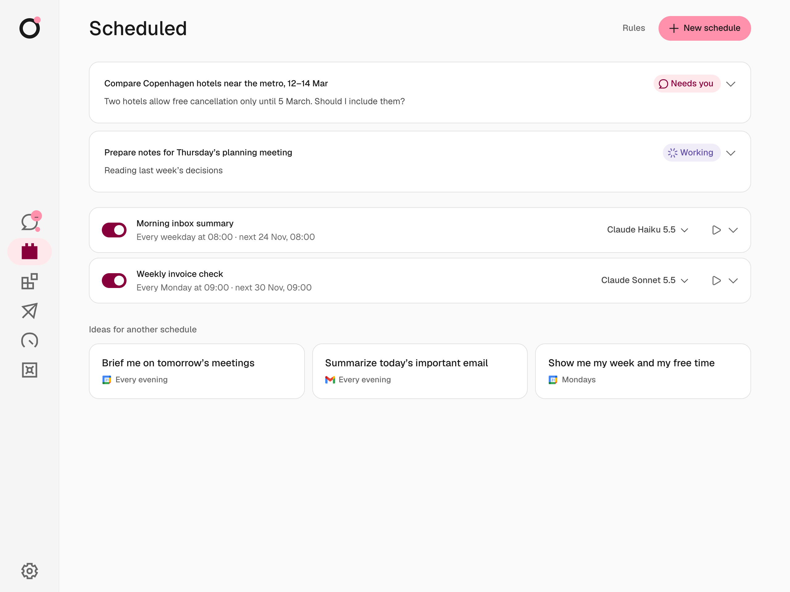
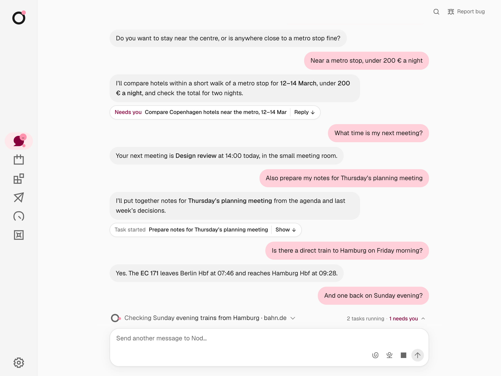
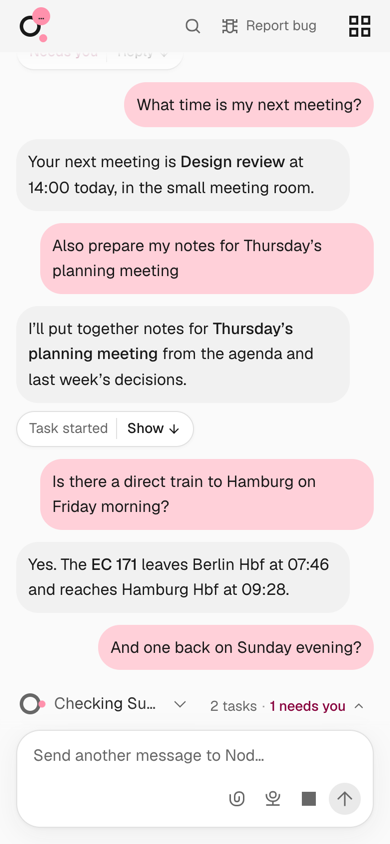
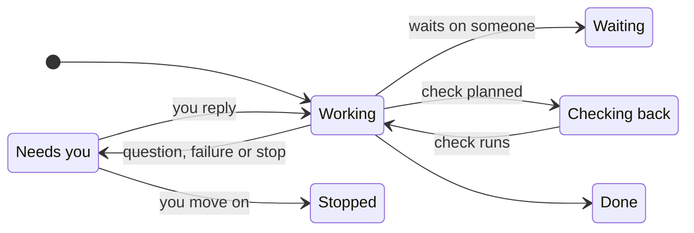

Each task has its own chat. The chat list on the left of the web app shows **Main** and one chat per task, so you can follow and continue each piece of work on its own. The **Scheduled** page holds open tasks, schedules and their recent runs. Select **New schedule** to open chat, where Nod helps you decide what to do and when.

Nod keeps quick answers, simple lookups and status questions in chat. It starts a saved task for substantial work, including multi-step work it can finish in one sitting, such as research across sources, checked comparisons or report creation, and for an outside wait, such as a person, a reply or an action elsewhere, or work you ask it to track. You never pick an execution mode: Nod starts the task itself and lets it finish the assigned work.

| You write                              | What Nod does                    |
| -------------------------------------- | -------------------------------- |
| "What time is my next meeting?"        | Answers in chat.                 |
| "Compare flights to Copenhagen."       | Starts task A.                   |
| "Also prepare my meeting notes."       | Starts task B while A continues. |
| "For the flights, only direct routes." | Updates task A.                  |
| "How are the flights going?"           | Reports task A's status in chat. |

The main chat stays available while tasks work. Each task keeps its goal and history, and its start message is its acknowledgement. Write in the task's chat to correct it or add a related update. A question about its progress is answered in chat.

Tasks share one [workspace](/use/workspace/#one-workspace-for-all-tasks), owner memory, rules, Vault and schedules. Each task has its own working folder and saved session. See [Task sessions](/how-it-works/task-sessions/) for the architecture.

## The chat list

The chat list sits to the left of the conversation. **Main** is your ongoing conversation with Nod. Below it, every task of this conversation has its own chat, grouped by state:

| Group         | Chats in it                                                         |
| ------------- | ------------------------------------------------------------------- |
| **Working**   | Tasks that are queued, working, waiting on someone or checking back |
| **Needs you** | Tasks with a question, an approval, a check-in or a failure         |
| **Done**      | Tasks that finished or were stopped                                 |

Select a chat to open it. A task's chat shows only that task. Its card sits at the top with its status, steps, activity and **Stop this task**. Below it are the task's own messages, questions, approvals and results. Whatever you type there goes to that task, and the composer's Stop control stops only that task. In the web app run from source, **Open the live browser** under the card opens that task's browser view in a new tab.

**Main** shows your conversation with Nod and the card of each task it started. To open a task's chat, select **Open chat** on its card or its pulsing dot above the message box. A task's questions, approvals and results appear in its own chat, not in **Main**.

### Start a new chat

Select **New chat**, then type what you want. Your first message starts a task directly, without going through the main chat. The task's title is the first line of your message. When Nod has your message, the app opens the new chat. You can start several new chats, and they run at the same time.

A new chat never answers anything outside itself. A "yes" in a new chat starts that chat. It doesn't approve an action that another chat or the main chat is waiting on.

### Continue or close a chat

Finished chats stay in the list under **Done**. Open one and type to continue it in the same saved session. It reopens and moves back to **Working**.

To hide a finished chat, select its **Close** button. Only finished or stopped chats can be closed, so stop a task first to close its chat. If you write to a closed chat again, for example after opening one of its messages from search, it comes back to the list.

## Scheduled work

Open **Scheduled** to review open tasks and upcoming schedules. Open tasks appear first, with the same live line as in chat. Expand **Inactive** for paused schedules. Open a schedule’s **See details → Runs** for its history. See [Schedules](/use/schedules/).

Select **Rules** to ask Nod in chat to show the rules that apply to every task. Tell Nod in chat what to change.

## What a card shows

| Part           | What it tells you                                                                 |
| -------------- | --------------------------------------------------------------------------------- |
| Title          | The task in a few words                                                           |
| Status         | Where the task stands, such as **Working** or **Needs you**                       |
| Now line       | What Nod is doing, with the website it's working in, or the question it asked you |
| **Waiting on** | Who Nod is waiting for, and how, such as an email reply                           |
| **Next check** | When Nod will look again                                                          |
| **Done when**  | What finished looks like                                                          |
| **Model**      | The model the task uses. Select **Change** to give this task its own model        |

A compact task preview appears in **Main** with its title, status and current activity, and at the top of the task's own chat. While a task works, its card has its own live line: the current step, the website or app it's working in, and how long it has been quiet. The chat's status line stays with your messages. While it works, a pulsing dot just above the top-right corner of the message box stands for it, and a pink dot with a question mark shows when it needs you. Hover over or focus the dot to see the task's title, or select it to open the task's chat.

The live line also shows up to four recent completed operations, with the newest first. Select the line to hide or show them. This control works separately from the task's details.

Select the preview's title to see its controls and, when it has planned steps, its plan as a checklist; select it again to close it. Inside, **Show activity** lists Nod's steps and messages with its tool steps in between, never private model reasoning.

Tasks Nod starts on its own, such as a reply your notification rule asks for, show the same line on their card, with no typing indicator or chat status line. Useful, verified milestones arrive as chat messages, with what is complete and what remains.

The progress indicator shows the task title above its current step. Both wrap so you can read the full text.

## Reply or stop one task

In the web app, open the task's chat and type to continue that task. Each message there replies to the chat's latest message from Nod, so a "yes" answers that task's own question or approval. In Telegram and WhatsApp, use their reply controls on the task's first message, a question or a result. A message in **Main**, or without a reply target in a chat app, goes to the main chat. Nod can send that message to one or more open tasks when your intent is clear. If the target is unclear, Nod asks. To pick up a finished or stopped task, write in its chat, or reply to one of its messages in a chat app.

When a task waits for you in its browser, its preview in chat and on **Scheduled** shows **Open browser**, which takes you to the live page. See [Take over the browser](/use/browser/#take-over-the-browser).

An owner update has a revision. **Owner update queued** means the task has not received it at an execution boundary. An outside action that has already started can still finish. Other tasks continue while one task waits for your answer.

To stop one task and its helpers, open its preview and select **Stop this task**, or use the Stop control in the task's chat. Other tasks continue. The Stop control in **Main** stops active work and closes all open tasks. You can also ask Nod in the main chat to stop one task, or all background work, including scheduled runs and app checks. Reset also closes the old thread's open tasks.

A task checks in when its spending since your last message to it passes the check-in amount, $5 by default, and asks whether to keep going. Tell Nod in chat to change the amount. See [Task check-ins](/use/spending/#task-check-ins).

## Rename a task

Open its preview and select its title in the details. Change the display name, then select **Save**. The task goal and original request stay the same. **Cancel** or Escape discards the edit.

## Inspect task activity

In chat, open a task preview and select **Show activity**. The details show planned steps, Nod's steps and messages, and the tool and helper steps between them, such as _Searched the web_ or _Gmail: send email_. Select **Open chat** to open the task's chat.

To see the commands the task ran in Nod's workspace, select **Show commands**. See [Watch Nod's commands](/use/workspace/#watch-nods-commands).

## Read task results

A task delivers its result where you asked for it. When you ask for something a connected app holds, such as a sheet, a document or email drafts, Nod creates it in that app even if you don't name it. Research, guides, plans and other long reports come as a Markdown document with a short message giving the main finding, and long answers outside a task come the same way. If you ask for the result in the chat itself, Nod writes it there in full. With the WhatsApp Cloud API, open Nod to read the document. A follow-up, such as completing a sign-in, continues the same saved session.

Every longer task you request uses the same [feedback rule](/use/chat/#feedback-during-long-tasks), with any tool or source. It balances useful early results against missing context and interruptions, and follows your delivery instructions. A result must be checked and useful on its own. The task states what it checked and what remains uncertain, then continues the full task. Later related findings arrive together. Routine activity stays on the task's live line. An acknowledgement, repeated finding, or elapsed time alone does not trigger a result message.

Select the file to read it in a panel next to the chat. Select **Download** to save it. Press **Escape** to close the panel. See [Get files from Nod](/use/workspace/#get-files-from-nod) for every file type the panel opens.

Nod previews Markdown files up to 4 MB. For a larger file, select **Download**.

A finished card has **Schedule task**, which turns the same work into a [schedule](/use/schedules/). Open [Usage](/use/spending/) to review the task's cost and recorded app actions.

## Use tasks on mobile

Mobile web uses the same compact previews. The chat list sits above the conversation. Open a task's chat to read its steps, write to it or stop it.

## Telegram and WhatsApp without a task page

Telegram and WhatsApp show each task as messages Nod writes in your language. The first one says what it is starting. Questions, approval requests and the result reply to that message, so they stay linked to the task.

Use the chat app's **Reply** control to send an update or answer to a task. Other messages go to the main chat. These commands answer from Nod's task records, and Nod words the reply:

| Command   | Result                                                                                                  |
| --------- | ------------------------------------------------------------------------------------------------------- |
| `/tasks`  | List open tasks and their current state.                                                                |
| `/status` | Show each open task's goal, steps and current state. Reply to a task message to see only that task.     |
| `/stop`   | Stop all active work and close open tasks. Reply to a task message with `/stop` to stop only that task. |

The task list sends one message per task. You can reply to that message, the task's first message, a question, a file, a result or a status response. If Nod cannot match a reply to a task, `/stop` asks you to select a task. It does not stop all work.

A status message that shows a pending question keeps a link to that exact question. Your approval applies only to the saved action it shows. An old status message cannot approve a later action.

Telegram, WhatsApp and web use the same task record and saved session. Task commands do not grant permission for an outside action. Private sign-in and payment steps still use Nod's private forms.

## Statuses

| Status            | Meaning                                                              |
| ----------------- | -------------------------------------------------------------------- |
| **Queued**        | The task is waiting for its session to run.                          |
| **Failed**        | The run failed. Reply to its message to continue.                    |
| **Working**       | Nod is on it right now.                                              |
| **Needs you**     | Nod asked you a question or needs an approval. Reply to its message. |
| **Waiting**       | Nod is waiting on someone else.                                      |
| **Checking back** | Nod has a check planned and resumes the task at that time.           |
| **Done**          | Finished, with the result on the card.                               |
| **Stopped**       | Closed before it finished.                                           |

A question stays **Needs you** until you reply to it or continue its session. An unrelated chat message does not answer it. A failed task opens its card, so **Open chat** and **Stop this task** are in view. A task that stops without a plan or a result shows **Needs you** with a note to reply to continue. A task that fails, including one Nod started on its own, says so in chat with the task's name and what stopped it. When a task reaches its spending check-in, it shows **Needs you** with the check-in question. A stopped task shows **Stopped**. Reply to the task to continue the same saved session. While a task works on your reply, the chat shows that Nod is working.

If you ask a question in main chat after a task's yes/no approval without replying directly, Nod closes that approval without running its action. The task remains open with a message that says its current work stopped. Reply to that message to continue what is unfinished.

If you pause or delete a schedule directly while a task is waiting for approval to change that schedule, the old confirmation expires. The task stays open and shows a new message you can reply to if it has more work to do.

## Task status and permission

A card is a view of the work. It does not grant permission. A planned check resumes the task's own session with the same permission as the task. **Schedule task** creates an ordinary [schedule](/use/schedules/). Every outside action still goes through the [trust check](/trust/approvals/).

To change a task, tell Nod in [chat](/use/chat/).

## Related resources

- [Chat with Nod](/use/chat/)
- [Schedules and background work](/use/schedules/)
- [Approvals and the trust check](/trust/approvals/)
